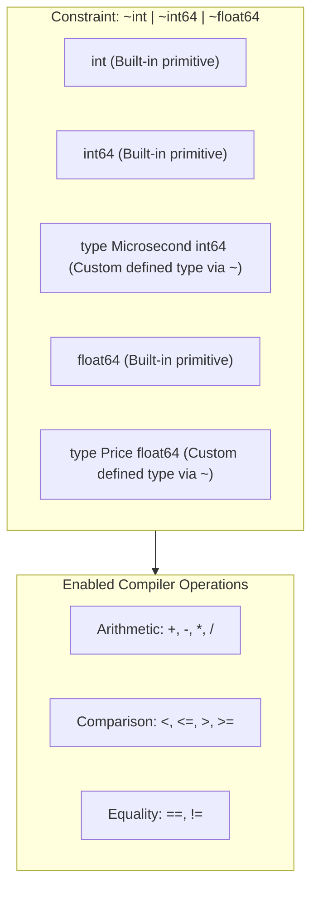

# Complex Generic Constraints

## When you need this

Use complex generic constraints when your generic functions require operators beyond basic equality (==), such as numerical arithmetic, bitwise shifts, string concatenation, or ordering comparisons (<, >), or when you must permit defined custom types (e.g., type UserID int64) to satisfy the generic interface.

## When you do not need this

Do not use complex constraints when standard library interfaces (like io.Reader, fmt.Stringer, or error) already capture the required behavioral contract through ordinary method signatures.

## Prerequisites

- core-16-15

## Mental model

In Go, an interface is a Type Set. A constraint interface defines a set of all types that are permitted to instantiate the type parameter. 

The approximation operator ~T means: "any type whose underlying type is T". For example, ~int matches both built-in int and custom domain types like type Quantity int.

## Visual model



## How it works

When the compiler type-checks a generic function body, it computes the core type of the constraint's type set. If every type in the type set supports the requested operation (such as addition or relational ordering), that operation is legally permitted on variables of that type parameter. The approximation operator ~ inspects the Go runtime _type metadata descriptor to verify whether the underlying type matches the declared constraint.

## Go example

```go
package main

import (
	"fmt"
)

// Number defines a constraint interface accepting any integer or floating-point type,
// including custom user-defined types having those underlying primitives.
type Number interface {
	~int | ~int8 | ~int16 | ~int32 | ~int64 |
		~uint | ~uint8 | ~uint16 | ~uint32 | ~uint64 |
		~float32 | ~float64
}

// Milliseconds is a custom defined type based on int64.
type Milliseconds int64

// Clamp bounds a number between min and max inclusive.
func Clamp[T Number](val, min, max T) T {
	if val < min {
		return min
	}
	if val > max {
		return max
	}
	return val
}

// Demo demonstrates Complex generic constraints and satisfies test requirements.
func Demo() string {
	var timeout Milliseconds = 1500
	bounded := Clamp(timeout, 100, 1000)
	floatVal := Clamp(3.14159, 0.0, 2.5)
	_ = bounded
	_ = floatVal
	return "Complex generic constraints verified"
}

func main() {
	fmt.Println(Demo())
}
```

## Step-by-step execution

1. The interface Number declares a type union combined with the ~ approximation operator.
2. The developer declares type Milliseconds int64.
3. Clamp(timeout, 100, 1000) is called. The compiler inspects Milliseconds and notes its underlying primitive is int64.
4. Because ~int64 is in the Number type set, the constraint is successfully satisfied.
5. The compiler generates concrete machine instructions for comparison and returns the clamped value directly in registers without dynamic dispatch.

## Tradeoffs

- Advantage: Domain Expressiveness: Allows custom domain types to participate in generic numerical calculations without explicit type conversions.
- Advantage: Strict Bounds: Prevents unsupported types from compiling, moving errors from runtime to compile time.
- Disadvantage: Signature Verbosity: Complex union definitions can become unwieldy without dedicated constraint alias packages.

## Common mistakes

| Mistake | Why it happens | Fix |
|---|---|---|
| Omitting the ~ tilde operator (e.g. int instead of ~int) | Forgetting that type Kilograms int is a distinct type from int | Use ~int to allow defined types |
| Mixing method requirements with empty type sets | Creating contradictory constraints | Ensure type union types implement all specified methods |

## Debugging walkthrough

### Scenario: Compiler error: "type Milliseconds does not implement Number (possibly missing ~ for int64 in constraint Number)"

**Cause:** The constraint definition used int64 instead of ~int64, strictly limiting the function to untyped and built-in int64 variables.

**Fix:** Add the approximation operator ~ before each type in the union:
```go
type Number interface {
    ~int | ~int64 | ~float64
}
```

## Practice task

Write a generic constraint Serializable that requires a type to implement both fmt.Stringer and have an underlying type of ~string | ~[]byte. Implement a function Checksum[T Serializable](val T) string that computes a hash.

## Production notes

Complex generic constraints are central to high-performance financial systems (currency conversions, rate calculation libraries) and distributed metric aggregators where custom duration and counter types must be clamped, summed, and averaged safely.

## Related core lessons

- Module 15.15 — Demo preparation
- Module 17.15 — Demo preparation
