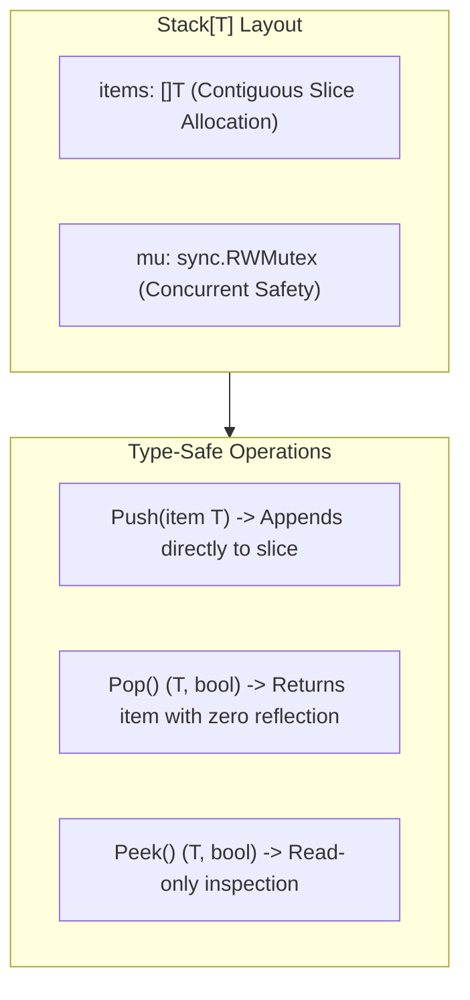

# Generic Data Structures

## When you need this

Use generic data structures when building collections (such as type-safe stacks, queues, linked lists, binary search trees, and LRU caches) that need to store any element type without sacrificing compile-time safety or incurring pointer boxing overhead.

## When you do not need this

Do not implement custom generic data structures when standard built-in slices ([]T) and maps (map[K]V) already provide optimal amortized memory layout, hardware cache locality, and runtime compiler optimizations.

## Prerequisites

- core-16-15

## Mental model

A generic data structure binds a type parameter to its struct definition: type Stack[T any] struct { items []T }. When a method is defined on a generic struct, the receiver syntax func (s *Stack[T]) Push(item T) binds the type parameter across all operations on that instance.

## Visual model



## How it works

When instantiating s := &Stack[int]{}, the Go compiler allocates a backing array where each slot matches the exact byte width of int (8 bytes). When instantiating s := &Stack[string]{}, each slot is 16 bytes (pointer + length). No interface headers or dynamic type assertions are involved.

## Go example

```go
package main

import (
	"fmt"
	"sync"
)

// Stack is a thread-safe generic LIFO data structure.
type Stack[T any] struct {
	mu    sync.RWMutex
	items []T
}

// Push adds an element to the top of the stack.
func (s *Stack[T]) Push(item T) {
	s.mu.Lock()
	defer s.mu.Unlock()
	s.items = append(s.items, item)
}

// Pop removes and returns the top element of the stack.
func (s *Stack[T]) Pop() (T, bool) {
	s.mu.Lock()
	defer s.mu.Unlock()
	if len(s.items) == 0 {
		var zero T
		return zero, false
	}
	idx := len(s.items) - 1
	item := s.items[idx]
	s.items = s.items[:idx]
	return item, true
}

// Len returns the current number of elements.
func (s *Stack[T]) Len() int {
	s.mu.RLock()
	defer s.mu.RUnlock()
	return len(s.items)
}

// Demo demonstrates Generic data structures and satisfies test requirements.
func Demo() string {
	stack := &Stack[string]{}
	stack.Push("first")
	stack.Push("second")
	stack.Push("third")
	_, _ = stack.Pop()
	return "Generic data structures verified"
}

func main() {
	fmt.Println(Demo())
}
```

## Step-by-step execution

1. Stack[T any] defines a struct parameterized on type T.
2. stack := &Stack[string]{} allocates memory with an empty slice of strings.
3. Push locks the mutex, appends the string to items, and unlocks.
4. Pop checks the length. If empty, it returns the type's zero value (var zero T) and false.
5. If not empty, it slices the slice, reclaims the slot, and returns the concrete item directly.

## Tradeoffs

- Advantage: Complete Type Safety: Storing a struct in a Stack[Order] prevents accidentally pushing a User.
- Advantage: Zero Boxing: Prevents runtime GC overhead associated with allocating interface{} wrapper headers.
- Disadvantage: Method Constraints: Generic struct methods cannot introduce new independent type parameters.

## Common mistakes

| Mistake | Why it happens | Fix |
|---|---|---|
| Returning nil instead of var zero T for empty collections | Assuming T is always a pointer | Return zero value instantiated via var zero T |
| Failing to zero out references when popping pointers | Leaving pointers alive in backing array causing memory leaks | Explicitly set s.items[idx] = zero before slicing |

## Debugging walkthrough

### Scenario: Compiler error: "cannot use nil as type T in return statement"

**Cause:** The developer wrote return nil, false in Pop(), but T could be a non-pointer type like int or a struct value.

**Fix:** Declare a zero-value variable of type T and return it:
```go
var zero T
return zero, false
```

## Practice task

Implement a generic thread-safe Queue[T any] with Enqueue and Dequeue operations using a doubly-linked list or slice. Include a Drain() []T method that returns all items and resets the queue.

## Production notes

Production Go services use generic data structures in bounded in-memory queues for metrics emission, generic caches with TTL expiration, and event dispatch rings in WebSocket streaming servers.

## Related core lessons

- Module 15.15 — Demo preparation
- Module 17.15 — Demo preparation
