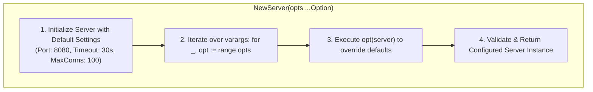

# Functional Options

## When you need this

Use the Functional Options pattern when designing public constructors for structs (such as HTTP clients, gRPC servers, connection pools, and service handlers) that have numerous configuration parameters with sensible defaults, optional overrides, and a requirement for future backwards compatibility without breaking API signatures.

## When you do not need this

Do not use functional options for simple internal structs with only one or two required fields. A standard struct literal Config{Host: "...", Port: 8080} is simpler and avoids function allocation overhead.

## Prerequisites

- core-16-15

## Mental model

Instead of creating a giant constructor with 10 arguments or multiple telescoping constructors (NewClient, NewClientWithTimeout, NewClientWithRetry), you define an option as a function: type Option func(*Server). The constructor applies sensible defaults first, then executes each passed option to mutate the configuration.

## Visual model



## How it works

Functional options take advantage of Go's first-class functions and closures. Each option function is instantiated with access to the target configuration struct. Because the options are variadic (...Option), callers can specify 0, 1, or many options without changing the constructor's signature over time.

## Go example

```go
package main

import (
	"fmt"
	"time"
)

// Server represents a configured network service.
type Server struct {
	Host     string
	Port     int
	Timeout  time.Duration
	MaxConns int
}

// Option defines a functional option signature for configuring a Server.
type Option func(*Server)

// WithHost overrides the default bind host.
func WithHost(host string) Option {
	return func(s *Server) {
		s.Host = host
	}
}

// WithPort overrides the default listening port.
func WithPort(port int) Option {
	return func(s *Server) {
		s.Port = port
	}
}

// WithTimeout configures the request timeout.
func WithTimeout(timeout time.Duration) Option {
	return func(s *Server) {
		s.Timeout = timeout
	}
}

// NewServer creates a new Server applying defaults and functional options.
func NewServer(opts ...Option) *Server {
	srv := &Server{
		Host:     "127.0.0.1",
		Port:     8080,
		Timeout:  30 * time.Second,
		MaxConns: 100,
	}
	for _, opt := range opts {
		opt(srv)
	}
	return srv
}

// Demo demonstrates Functional options and satisfies test requirements.
func Demo() string {
	srv := NewServer(
		WithHost("0.0.0.0"),
		WithPort(9090),
		WithTimeout(5*time.Second),
	)
	_ = srv
	return "Functional options verified"
}

func main() {
	fmt.Println(Demo())
}
```

## Step-by-step execution

1. The package defines a target struct Server with private or public configuration fields.
2. The type definition type Option func(*Server) establishes the option contract.
3. Option helper functions like WithPort(int) return closures capturing their arguments.
4. NewServer initializes a Server pointer with safe default values.
5. NewServer iterates over the opts variadic slice, executing each closure in order.
6. The caller receives a fully validated, production-ready *Server instance.

## Tradeoffs

- Advantage: Backwards Compatibility: Adding 5 new options tomorrow does not break existing code calling NewServer().
- Advantage: Clean Call Sites: Callers only specify the options they care about, keeping code readable.
- Disadvantage: Small Allocation Overhead: Constructing closures can cause small heap allocations if options escape to the heap.

## Common mistakes

| Mistake | Why it happens | Fix |
|---|---|---|
| Returning an error from every option | Making option signatures unnecessarily verbose | Validate configuration in NewServer rather than inside options |
| Mutating global state inside option functions | Misusing closures | Strictly mutate the passed struct instance |

## Debugging walkthrough

### Scenario: Option order inadvertently overwrites mutually exclusive settings

**Cause:** Options are applied strictly in the order they are passed in the variadic slice. If WithTLS() is called before an option that disables security, the later option silently overrides the earlier one.

**Fix:** Validate configuration consistency *after* the options loop completes:
```go
func NewServer(opts ...Option) (*Server, error) {
    srv := defaultServer()
    for _, opt := range opts { opt(srv) }
    if srv.UseTLS && srv.TLSCert == "" {
        return nil, errors.New("TLS enabled but cert missing")
    }
    return srv, nil
}
```

## Practice task

Create a DatabasePool constructor using the functional options pattern with options for WithMaxIdleConns, WithMaxOpenConns, and WithConnMaxLifetime. Include validation that rejects MaxIdleConns > MaxOpenConns.

## Production notes

The functional options pattern is universally used in production Go libraries including grpc.NewServer(), zap.New(), and Google Cloud Go SDK client constructors.

## Related core lessons

- Module 15.15 — Demo preparation
- Module 17.15 — Demo preparation
