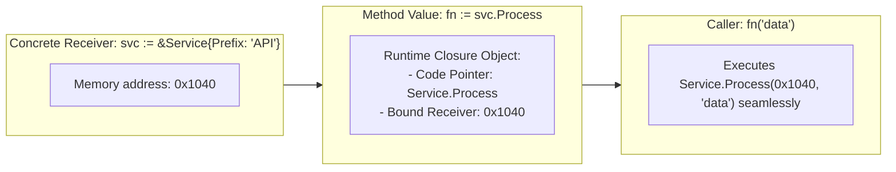

# Method Values

## When you need this

Use method values when you need to pass an object's method as a first-class callback, HTTP handler, or event listener without writing repetitive wrapper closures like func(w http.ResponseWriter, r *http.Request) { s.Handle(w, r) }.

## When you do not need this

Do not use method values if the receiver is a value type that is mutated, because the method value captures a copy of the receiver at evaluation time, ignoring subsequent mutations.

## Prerequisites

- core-16-15

## Mental model

In Go, functions and methods are first-class citizens.
- A Method Expression like (*Service).Process yields a function where the receiver is the first argument: func(s *Service, arg string).
- A Method Value like svc.Process binds the concrete receiver svc to the method, producing a function value with the receiver already sealed inside: func(arg string).

## Visual model



## How it works

When evaluating f := instance.Method, the Go compiler constructs a two-word interface-like closure: the first word points to the generated trampoline machine code, and the second word points to the captured receiver instance. Invoking f() directly dispatches to the method with the receiver passed in the appropriate register.

## Go example

```go
package main

import (
	"fmt"
)

// Dispatcher manages route handling via first-class function callbacks.
type Dispatcher struct {
	handlers map[string]func(string) string
}

func NewDispatcher() *Dispatcher {
	return &Dispatcher{handlers: make(map[string]func(string) string)}
}

func (d *Dispatcher) Register(name string, handler func(string) string) {
	d.handlers[name] = handler
}

func (d *Dispatcher) Dispatch(name, payload string) (string, error) {
	h, ok := d.handlers[name]
	if !ok {
		return "", fmt.Errorf("handler not found: %s", name)
	}
	return h(payload), nil
}

// UserGateway demonstrates methods bound as method values.
type UserGateway struct {
	Environment string
}

func (g *UserGateway) ProcessUser(id string) string {
	return fmt.Sprintf("[%s] user %s validated", g.Environment, id)
}

// Demo demonstrates Method values and satisfies test requirements.
func Demo() string {
	dispatcher := NewDispatcher()
	gateway := &UserGateway{Environment: "prod"}
	dispatcher.Register("user.process", gateway.ProcessUser)
	_, _ = dispatcher.Dispatch("user.process", "usr_42")
	return "Method values verified"
}

func main() {
	fmt.Println(Demo())
}
```

## Step-by-step execution

1. The UserGateway struct declares a method ProcessUser(string) string.
2. In Demo(), an instance gateway := &UserGateway{Environment: "prod"} is created.
3. gateway.ProcessUser is passed directly to Register. The Go compiler automatically creates a method value binding gateway.
4. When dispatcher.Dispatch calls h(payload), Go calls ProcessUser with gateway passed as the receiver.
5. The result preserves access to gateway.Environment without requiring an explicit anonymous closure.

## Tradeoffs

- Advantage: Conciseness: Eliminates boilerplate anonymous function wrappers when registering handlers with http.HandleFunc.
- Advantage: Decoupled Design: Dispatchers depend only on function signatures (func(string) string), not on specific struct types.
- Disadvantage: Subtle Copying Risk: If the receiver is a value type rather than a pointer, mutations on the original struct will not be seen by the method value.

## Common mistakes

| Mistake | Why it happens | Fix |
|---|---|---|
| Binding a method value to a value receiver expecting mutations | Method values copy value receivers at creation time | Use pointer receivers (*Type) for types whose state changes |
| Assuming method values can be compared with == | Functions and method values are not comparable in Go | Use identifiers or register keys to distinguish handlers |

## Debugging walkthrough

### Scenario: Handler uses old state after struct was updated

**Cause:** The method had a value receiver (func (u User) GetName()), so u.GetName copied the struct at the moment the method value was created.

**Fix:** Change the receiver to a pointer (func (u *User) GetName()), ensuring the method value captures a pointer to the live memory address.

## Practice task

Refactor an HTTP route registry to register struct methods (srv.HandleGet, srv.HandlePost) using method values with http.HandlerFunc. Verify that requests correctly read shared server state.

## Production notes

Method values are heavily used in standard library HTTP routing (http.HandleFunc("/users", srv.handleUsers)), worker pool task dispatching, and event subscription buses.

## Related core lessons

- Module 15.15 — Demo preparation
- Module 17.15 — Demo preparation
