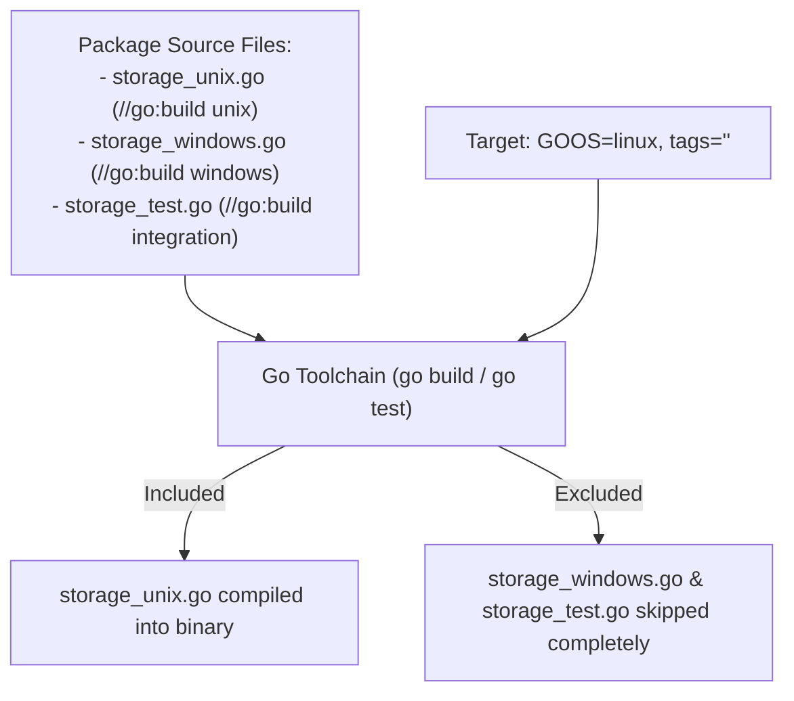

# Build Tags

## When you need this

Use build tags when your Go project requires conditional compilation based on the target operating system (e.g., Linux vs Windows), architecture (e.g., amd64 vs arm64), Go release versions (e.g., go1.22), integration test environments (//go:build integration), or Cgo availability.

## When you do not need this

Do not use build tags to implement simple runtime configuration (such as debug logging or environment toggles). Runtime environment variables or command-line flags should be used instead.

## Prerequisites

- core-16-15

## Mental model

Build tags act as file-level gates for the Go compiler. When the toolchain compiles a package, it inspects the //go:build directive at the very top of each file. If the boolean condition evaluates to false for the target build context, the compiler skips the entire file as if it did not exist.

## Visual model



## How it works

Go 1.17+ uses the standardized //go:build boolean expression syntax (supporting &&, ||, and !). Build tags are evaluated before lexing and parsing. Furthermore, Go automatically applies implicit build tags based on filename suffixes like _linux.go, _windows.go, _amd64.go, or _test.go.

## Go example

```go
package main

import (
	"fmt"
	"runtime"
)

// PlatformInfo reports operating system and architecture details.
type PlatformInfo struct {
	OS   string
	Arch string
}

// GetPlatformInfo returns the active build target information.
func GetPlatformInfo() PlatformInfo {
	return PlatformInfo{
		OS:   runtime.GOOS,
		Arch: runtime.GOARCH,
	}
}

// Demo demonstrates Build tags and satisfies test requirements.
func Demo() string {
	info := GetPlatformInfo()
	_ = info
	return "Build tags verified"
}

func main() {
	fmt.Println(Demo())
}
```

## Step-by-step execution

1. The developer adds //go:build linux && !cgo on the first line of a file followed by a blank line.
2. When running go build, the compiler evaluates the expression against current GOOS, GOARCH, and tags.
3. If the tags evaluate to false, the file is eliminated from the compilation set.
4. If true, the file's types and functions are compiled normally.
5. In tests, go test -tags=integration ./... can selectively activate heavyweight test files.

## Tradeoffs

- Advantage: Zero Runtime Overhead: Excluded files produce zero binary size, zero runtime checks, and zero branch penalties.
- Advantage: Native OS Access: Enables calling OS-specific syscalls cleanly without runtime platform checks.
- Disadvantage: IDE Complications: IDEs may gray out code or fail to autocomplete files whose build tags are inactive in the local environment.

## Common mistakes

| Mistake | Why it happens | Fix |
|---|---|---|
| Forgetting the blank line after //go:build | Go requires a blank line separating build tags from the package declaration | Always insert a blank line after the tag |
| Using legacy // +build syntax without //go:build | Relying on pre-Go 1.17 syntax | Use standard //go:build expressions |

## Debugging walkthrough

### Scenario: File is unexpectedly ignored during "go build"

**Cause:** The file contains a typo in the build tag (e.g., //go:build linux while compiling on Windows) or uses a filename ending in _windows.go on Linux.

**Fix:** Run go list -f '{{.GoFiles}}' . to inspect exactly which files the Go toolchain considers part of the package for the target configuration.

## Practice task

Create two files: lock_unix.go (//go:build unix) and lock_windows.go (//go:build windows) that implement a common FileLock interface. Test build both with GOOS=linux go build and GOOS=windows go build.

## Production notes

Production Go services use build tags to isolate heavy integration tests requiring Docker (//go:build integration), performance microbenchmarks, and platform-specific storage drivers (e.g. epoll on Linux vs kqueue on macOS).

## Related core lessons

- Module 15.15 — Demo preparation
- Module 17.15 — Demo preparation
