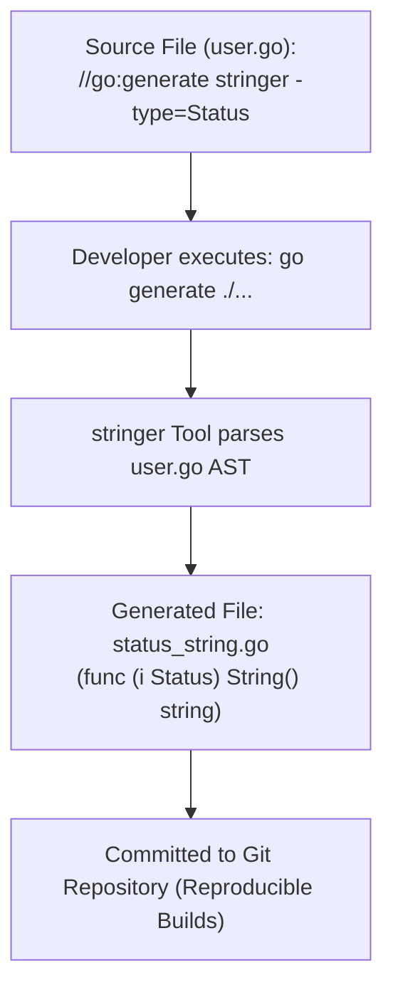

# go generate

## When you need this

Use go generate to automate repetitive source code generation tasks such as string enum implementations (stringer), mock generators (mockery, mockgen), SQL query generation (sqlc), and Protobuf/gRPC compilation (protoc).

## When you do not need this

Do not use go generate during standard runtime initialization or in ordinary compilation pipelines that have no code generation needs. go generate is a developer-driven tooling command, not a build step.

## Prerequisites

- core-16-15

## Mental model

go generate is a command runner that scans your .go files for comment directives formatted as //go:generate <command> <args>. When invoked, it executes the specified tools in sequence and outputs generated .go files directly into your source tree, which are then committed to version control.

## Visual model



## How it works

When running go generate, the Go tool searches for comments starting precisely with //go:generate (no leading spaces). It sets environment variables like $GOFILE, $GOPACKAGE, and $GOLINE so the generator knows the exact context of the declaration. The generator writes code to disk, which is subsequent compiled by ordinary go build.

## Go example

```go
package main

import (
	"fmt"
)

//go:generate echo "Generating assets for user status..."

// Status represents the state of an account.
type Status int

const (
	StatusPending Status = iota
	StatusActive
	StatusSuspended
)

// String provides a human-readable representation of Status.
func (s Status) String() string {
	switch s {
	case StatusPending:
		return "Pending"
	case StatusActive:
		return "Active"
	case StatusSuspended:
		return "Suspended"
	default:
		return fmt.Sprintf("Status(%d)", s)
	}
}

// Demo demonstrates go generate and satisfies test requirements.
func Demo() string {
	s := StatusActive
	_ = s.String()
	return "go generate verified"
}

func main() {
	fmt.Println(Demo())
}
```

## Step-by-step execution

1. Developer annotates an enum with //go:generate stringer -type=Status.
2. Developer runs go generate ./... in the terminal.
3. The tool resolves the stringer binary from $PATH or go.mod tool dependencies.
4. stringer parses the Go source file's AST, extracts all enum constants, and creates status_string.go.
5. The generated file becomes part of the package and is compiled without additional overhead during go build.

## Tradeoffs

- Advantage: Automated Correctness: Eliminates manual human errors when keeping string mappings and mocks synchronized with evolving structs.
- Advantage: Zero Build Lag for CI: Because generated code is checked into Git, CI and production Docker builds do not need code generators installed.
- Disadvantage: Drift Risk: Developers might forget to re-run go generate after modifying an enum.

## Common mistakes

| Mistake | Why it happens | Fix |
|---|---|---|
| Putting a space between // and go:generate | Syntax requires //go:generate without spaces | Ensure no whitespace follows the double slash |
| Running go generate during Docker production builds | Adding unnecessary compilers and tools to production images | Commit generated files to Git and verify in CI |

## Debugging walkthrough

### Scenario: CI detects that generated code is out of date

**Cause:** A developer added a new constant to an enum but forgot to run go generate before committing.

**Fix:** Add a CI validation step that runs go generate ./... followed by git diff --exit-code. If any files are modified, fail the build and instruct the developer to re-generate.

## Practice task

Add a //go:generate directive that uses the stringer tool to generate a String() method for an OrderStatus enum. Run go generate and inspect the generated file.

## Production notes

Production engineering teams enforce code generation consistency by pinning generator versions in tools.go and validating with git status --porcelain in GitHub Actions workflows.

## Related core lessons

- Module 15.15 — Demo preparation
- Module 17.15 — Demo preparation
