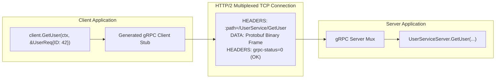

# gRPC Fundamentals

## When you need this

Use gRPC when building low-latency, high-throughput inter-service communication across backend microservices, where strongly-typed API contracts, multiplexed HTTP/2 connections, streaming support, and cross-language client generation provide substantial advantages over REST.

## When you do not need this

Do not use gRPC for public web client APIs that require direct browser consumption (without gRPC-Web proxy complexity), or for simple internal CRUD tools where standard JSON/HTTP endpoints are sufficient.

## Prerequisites

- core-16-15

## Mental model

gRPC elevates remote procedure calls to language-native function calls: resp, err := client.GetUser(ctx, req). Under the hood, gRPC serializes request structs into Protobuf, transmits them over an HTTP/2 multiplexed TCP stream, and decodes the response on the other side seamlessly.

## Visual model



## How it works

gRPC communicates strictly over HTTP/2. A single persistent TCP connection multiplexes hundreds of concurrent requests via independent HTTP/2 streams. gRPC headers are sent as HTTP/2 HEADERS frames, payload bytes as DATA frames, and the final completion status is returned in trailing headers (grpc-status: 0 for OK).

## Go example

```go
package main

import (
	"context"
	"fmt"
)

// UserRequest represents a gRPC input message.
type UserRequest struct {
	ID int64
}

// UserResponse represents a gRPC output message.
type UserResponse struct {
	ID    int64
	Name  string
	Email string
}

// UserService defines the RPC contract.
type UserService interface {
	GetUser(ctx context.Context, req *UserRequest) (*UserResponse, error)
}

// UserServer implements UserService.
type UserServer struct{}

func (s *UserServer) GetUser(ctx context.Context, req *UserRequest) (*UserResponse, error) {
	if req.ID <= 0 {
		return nil, fmt.Errorf("invalid user ID: %d", req.ID)
	}
	return &UserResponse{
		ID:    req.ID,
		Name:  "Alice Gopher",
		Email: "alice@example.com",
	}, nil
}

// Demo demonstrates gRPC fundamentals and satisfies test requirements.
func Demo() string {
	server := &UserServer{}
	_, _ = server.GetUser(context.Background(), &UserRequest{ID: 42})
	return "gRPC fundamentals verified"
}

func main() {
	fmt.Println(Demo())
}
```

## Step-by-step execution

1. Developer defines service in proto: service UserService { rpc GetUser(UserRequest) returns (UserResponse); }.
2. protoc generates Go client stubs and server interface contracts.
3. The server implements the interface methods.
4. The client initializes a single persistent HTTP/2 connection pool via grpc.Dial.
5. When client.GetUser is called, the request is serialized, streamed across an HTTP/2 frame, and the unblocked response is returned.

## Tradeoffs

- Advantage: High Throughput: Multiplexing dozens of requests over a single TCP connection prevents socket exhaustion and handshake latency.
- Advantage: Contract Enforcement: Code generation guarantees that client and server types remain in lockstep.
- Disadvantage: Tooling Complexity: Debugging binary frames requires specialized tools like grpcurl rather than standard curl.

## Common mistakes

| Mistake | Why it happens | Fix |
|---|---|---|
| Creating a new grpc.ClientConn for every request | Treating gRPC like HTTP/1.1 connections | Reuse a single long-lived client connection across the entire application |
| Ignoring context deadlines on RPC calls | Risking hung goroutines during network partitions | Always supply context.WithTimeout to gRPC client calls |

## Debugging walkthrough

### Scenario: Client receives "rpc error: code = Unavailable desc = connection error"

**Cause:** The target gRPC server is offline, the port is blocked by firewall rules, or HTTP/2 TLS negotiation (ALPN) failed.

**Fix:** Use grpcurl -plaintext <host>:<port> list to verify basic connectivity, verify DNS resolution, and check whether TLS certificates match the requested server name.

## Practice task

Implement a mock gRPC client that wraps UserService and handles retries with exponential backoff for transient errors. Verify that calls succeed when a transient error is cleared.

## Production notes

gRPC is the primary transport layer for Google Cloud, CockroachDB, Kubernetes internal APIs, and high-performance microservice meshes worldwide.

## Related core lessons

- Module 15.15 — Demo preparation
- Module 17.15 — Demo preparation
