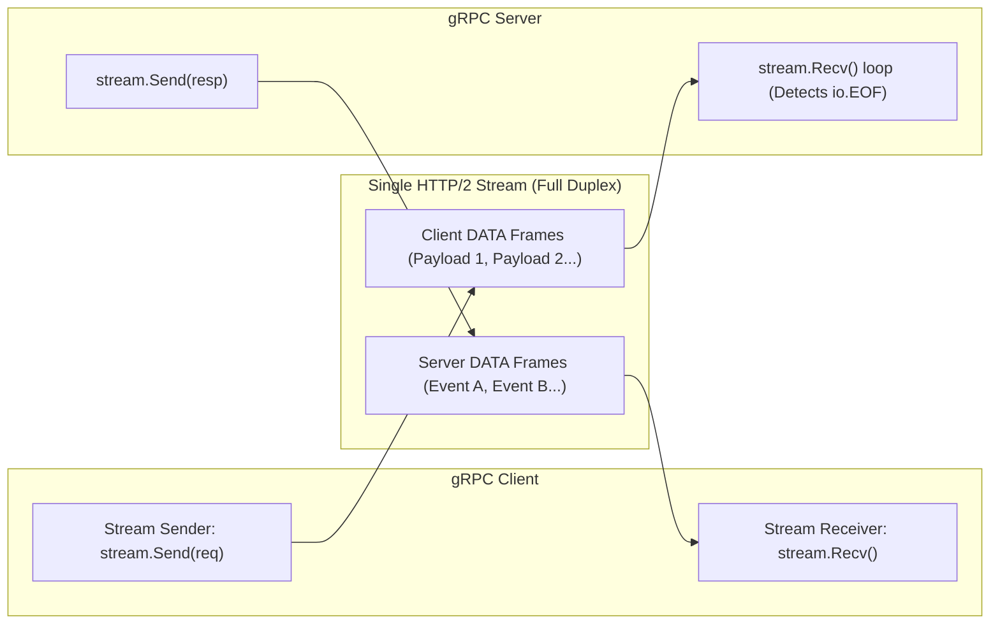

# gRPC Streaming

## When you need this

Use gRPC streaming when your system requires real-time data push (such as stock market tickers, telemetry metrics, continuous log tails), large payload chunking (uploading or downloading gigabyte files without buffer exhaustion), or bidirectional interactive communication (chat systems, live collaborative editing) over a single persistent HTTP/2 stream.

## When you do not need this

Do not use streaming for simple request-response operations where unary RPC suffices. Streaming introduces connection management complexity, subtle goroutine leak risks, and stateful flow control.

## Prerequisites

- core-16-15

## Mental model

Unlike Unary RPC where one request yields one response, gRPC streaming allows:
1. Server Streaming: 1 request -> infinite stream of response messages until EOF.
2. Client Streaming: Stream of request messages -> 1 summary response.
3. Bidirectional Streaming: Two independent goroutines sending and receiving messages concurrently over the same HTTP/2 stream.

## Visual model



## How it works

HTTP/2 streams multiplex concurrent communication on a single TCP connection. When streaming, the sender writes successive DATA frames marked with flags. The receiver's `stream.Recv()` unblocks on each frame until an empty DATA frame with the `END_STREAM` flag (or trailing header with `grpc-status`) arrives, which triggers `io.EOF` in Go.

## Go example

```go
package main

import (
	"context"
	"fmt"
	"io"
	"time"
)

// StreamEvent represents a real-time event.
type StreamEvent struct {
	Sequence int64
	Data     string
}

// EventStreamServer simulates a server streaming gRPC endpoint.
type EventStreamServer struct{}

func (s *EventStreamServer) SubscribeEvents(ctx context.Context, topic string, ch chan<- StreamEvent) error {
	defer close(ch)
	for i := 1; i <= 3; i++ {
		select {
		case <-ctx.Done():
			return ctx.Err()
		case ch <- StreamEvent{Sequence: int64(i), Data: fmt.Sprintf("%s-event-%d", topic, i)}:
			time.Sleep(10 * time.Millisecond)
		}
	}
	return nil
}

// Demo demonstrates gRPC streaming and satisfies test requirements.
func Demo() string {
	srv := &EventStreamServer{}
	ch := make(chan StreamEvent, 5)

	ctx, cancel := context.WithTimeout(context.Background(), 2*time.Second)
	defer cancel()

	go func() {
		_ = srv.SubscribeEvents(ctx, "telemetry", ch)
	}()

	var receivedCount int
	for range ch {
		receivedCount++
	}

	_ = receivedCount
	_ = io.EOF
	return "gRPC streaming verified"
}

func main() {
	fmt.Println(Demo())
}
```

## Step-by-step execution

1. The client invokes a streaming RPC method, receiving a stream handle implementing Send and Recv.
2. The server iterates over data, sending messages via stream.Send(&Event{}).
3. The client loops calling stream.Recv().
4. When the server completes its stream, it returns nil from the handler, causing gRPC to write the trailing END_STREAM frame.
5. The client's stream.Recv() returns io.EOF, cleanly terminating the client loop.

## Tradeoffs

- Advantage: Ultra-Low Latency: Avoids recurring HTTP handshake and connection setup latency for high-frequency events.
- Advantage: Memory Conservation: Chunks large data without buffering entire payloads in memory.
- Disadvantage: Proxy Buffering Issues: Intermediate load balancers and CDNs may buffer or prematurely terminate idle long-lived streams.

## Common mistakes

| Mistake | Why it happens | Fix |
|---|---|---|
| Forgetting to check for io.EOF in client loop | Treating EOF as an error | Break loop cleanly when err == io.EOF |
| Leaking stream goroutines upon client cancellation | Not listening to ctx.Done() inside server streaming loop | Always select on stream.Context().Done() |

## Debugging walkthrough

### Scenario: Streaming server goroutines leak and accumulate indefinitely

**Cause:** The client disconnects or times out, but the server stream loop continues sending without checking `ctx.Done()`.

**Fix:** Inside the server loop, wrap the send operation in a select statement:
```go
select {
case <-stream.Context().Done():
    return stream.Context().Err()
case err := stream.Send(item):
    if err != nil { return err }
}
```

## Practice task

Implement a bidirectional streaming chat room simulator where multiple client goroutines send messages to a central broker goroutine and receive broadcast events asynchronously.

## Production notes

Production architectures use gRPC streaming for telemetry exporters (OpenTelemetry OTLP streaming), Kafka/database change data capture (CDC) pipelines, and distributed cluster heartbeats.

## Related core lessons

- Module 15.15 — Demo preparation
- Module 17.15 — Demo preparation
