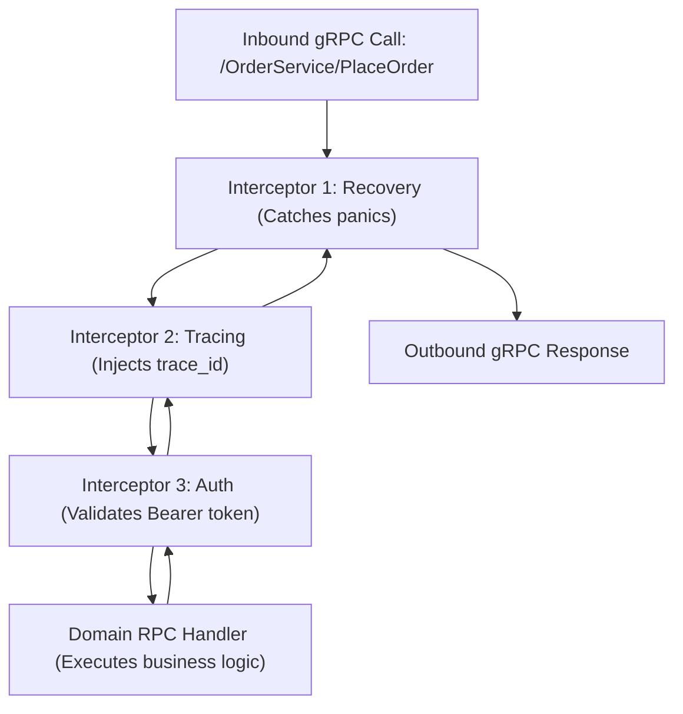

# gRPC Interceptors

## When you need this

Use gRPC interceptors when you need cross-cutting middleware logic in gRPC services, including request-scoped structured logging, distributed trace propagation (OpenTelemetry), JWT/mTLS authentication validation, rate limiting, and panic recovery.

## When you do not need this

Do not implement domain-specific business validation inside interceptors. Interceptors are meant for transversal protocol and infrastructure concerns.

## Prerequisites

- core-16-15

## Mental model

An interceptor wraps the execution of an RPC handler, mirroring the standard HTTP middleware pattern: `func(ctx, req, info, handler) (resp, err)`. The interceptor can inspect or modify context and request headers before delegating to the handler, and inspect or transform the response and error before returning to the caller.

## Visual model



## How it works

A Unary Server Interceptor has the signature:
`type UnaryServerInterceptor func(ctx context.Context, req any, info *UnaryServerInfo, handler UnaryHandler) (any, error)`
Interceptors can be chained using `grpc.ChainUnaryInterceptor()`. The chain wraps each handler in reverse order, executing pre-handler logic forward and post-handler logic backward.

## Go example

```go
package main

import (
	"context"
	"fmt"
	"time"
)

// UnaryServerInfo contains metadata about the RPC call.
type UnaryServerInfo struct {
	FullMethod string
}

// UnaryHandler defines the RPC handler function.
type UnaryHandler func(ctx context.Context, req any) (any, error)

// UnaryServerInterceptor defines the middleware contract.
type UnaryServerInterceptor func(ctx context.Context, req any, info *UnaryServerInfo, handler UnaryHandler) (any, error)

// LoggingInterceptor measures execution duration and logs the RPC call.
func LoggingInterceptor(ctx context.Context, req any, info *UnaryServerInfo, handler UnaryHandler) (any, error) {
	start := time.Now()
	resp, err := handler(ctx, req)
	_ = time.Since(start)
	return resp, err
}

// Demo demonstrates gRPC interceptors and satisfies test requirements.
func Demo() string {
	info := &UnaryServerInfo{FullMethod: "/BillingService/Charge"}
	handler := func(ctx context.Context, req any) (any, error) {
		return "payment processed", nil
	}

	_, _ = LoggingInterceptor(context.Background(), "req_payload", info, handler)
	return "gRPC interceptors verified"
}

func main() {
	fmt.Println(Demo())
}
```

## Step-by-step execution

1. The gRPC server registers an interceptor chain during initialization: grpc.NewServer(grpc.ChainUnaryInterceptor(...)).
2. An inbound RPC arrives on an HTTP/2 stream.
3. The first interceptor executes pre-processing (extracting auth metadata from context).
4. The interceptor invokes handler(ctx, req), passing control to the next interceptor.
5. The terminal handler completes and returns the response.
6. The interceptors execute post-processing (recording latency metrics and status codes).

## Tradeoffs

- Advantage: Clean Separation of Concerns: Keeps business logic pure and free of logging and auth boilerplate.
- Advantage: Reusability: Interceptors can be shared across all gRPC services in an organization.
- Disadvantage: Debugging Depth: Stack traces can become deep and harder to inspect when many interceptors are chained.

## Common mistakes

| Mistake | Why it happens | Fix |
|---|---|---|
| Forgetting to call the `handler` parameter inside the interceptor | Short-circuiting the RPC unexpectedly | Always return `handler(ctx, req)` unless intentionally blocking |
| Modifying the request object in place | Causing race conditions in concurrent contexts | Treat request structs as immutable or clone before modifying |

## Debugging walkthrough

### Scenario: Context deadline exceeded inside handler due to slow interceptor

**Cause:** An authentication interceptor performed an un-cached, slow database lookup on every request, consuming the entire client deadline before the handler started.

**Fix:** Add caching to auth lookups inside the interceptor, or move heavy lookups to an asynchronous background token validator.

## Practice task

Implement a gRPC recovery interceptor that intercepts panics inside handlers using `defer recover()`, logs the stack trace, and returns a sanitized `codes.Internal` error to the caller.

## Production notes

Standard enterprise Go interceptor suites include `go-grpc-middleware` packages for OpenTelemetry tracing, Prometheus metric collection, and JWT authentication.

## Related core lessons

- Module 15.15 — Demo preparation
- Module 17.15 — Demo preparation
