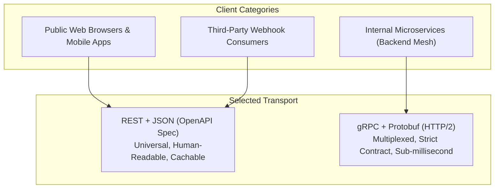

# REST vs gRPC Tradeoffs

## When you need this

Evaluate REST vs gRPC when architecting distributed systems to choose the optimal communication protocol for each interface boundary: typically REST/JSON for public browser and third-party APIs, and gRPC/Protobuf for internal service-to-service communication.

## When you do not need this

Do not default blindly to gRPC or REST for every interface. Understanding their distinct trade-offs ensures you don't over-engineer simple webhooks or under-engineer high-throughput inter-service backbones.

## Prerequisites

- core-16-15

## Mental model

Protocol selection is a trade-off between **interoperability** and **performance**:
- **REST (JSON over HTTP/1.1):** Universal, human-readable, browser-native, but higher CPU overhead and larger wire payloads.
- **gRPC (Protobuf over HTTP/2):** High performance, binary serialization, multiplexed connections, code-generated contracts, but requires specialized tooling and proxies for web browser access.

## Visual model



## How it works

REST uses ASCII text parsing (JSON strings, commas, brackets) and one TCP connection per request (or sequential keep-alive pipelining). gRPC packs data into binary Varints and length-delimited bytes, multiplexing hundreds of parallel RPC streams across a single persistent TCP connection.

## Go example

```go
package main

import (
	"fmt"
)

// ProtocolComparison summarizes the technical attributes of each protocol.
type ProtocolComparison struct {
	Protocol    string
	PayloadType string
	Transport   string
	Multiplexed bool
	BrowserOK   bool
}

// CompareProtocols returns the architecture trade-off matrix.
func CompareProtocols() []ProtocolComparison {
	return []ProtocolComparison{
		{
			Protocol:    "REST",
			PayloadType: "JSON (Text)",
			Transport:   "HTTP/1.1 or HTTP/2",
			Multiplexed: false,
			BrowserOK:   true,
		},
		{
			Protocol:    "gRPC",
			PayloadType: "Protobuf (Binary)",
			Transport:   "HTTP/2",
			Multiplexed: true,
			BrowserOK:   false, // Requires gRPC-Web proxy
		},
	}
}

// Demo demonstrates REST vs gRPC tradeoffs and satisfies test requirements.
func Demo() string {
	comparisons := CompareProtocols()
	_ = comparisons
	return "REST vs gRPC tradeoffs verified"
}

func main() {
	fmt.Println(Demo())
}
```

## Step-by-step execution

1. Evaluate the caller: Is it an untrusted public web browser or an internal backend service?
2. If public web browser, choose REST/JSON to avoid gRPC-Web proxy overhead and enable standard HTTP caching.
3. If internal backend service, choose gRPC/Protobuf to benefit from strict compile-time contracts, small payloads, and multiplexed connections.
4. Use a reverse proxy (like grpc-gateway or Envoy) if you need to expose a single gRPC backend as both gRPC and REST simultaneously.

## Tradeoffs

- REST Advantage: Universal browser support, simple debugging with curl, easy caching via HTTP headers (ETag, Cache-Control).
- REST Disadvantage: Higher network serialization overhead, loose contracts prone to drift.
- gRPC Advantage: 5-10x faster serialization, multiplexed single TCP connection, streaming capabilities.
- gRPC Disadvantage: Binary payloads not human-readable without schema, requires specialized ingress proxies for browser access.

## Common mistakes

| Mistake | Why it happens | Fix |
|---|---|---|
| Forcing gRPC directly onto web frontends | Ignoring browser inability to control HTTP/2 frames directly | Use REST or grpc-gateway for frontend ingestion |
| Using REST for high-frequency internal microservice pipelines | Incurring massive JSON serialization and connection handshake overhead | Migrate internal service backbones to gRPC |

## Debugging walkthrough

### Scenario: Internal microservice mesh suffers socket exhaustion under load

**Cause:** Microservices communicate using REST with an un-pooled `http.Client`, creating thousands of ephemeral TCP connections in `TIME_WAIT` status.

**Fix:** Migrate internal inter-service calls to gRPC, which multiplexes traffic across a small, persistent pool of HTTP/2 connections.

## Practice task

Write an architectural decision record (ADR) comparing REST and gRPC for an internal billing notification pipeline. Include concrete benchmarks evaluating payload sizes for a 1,000-item transaction batch.

## Production notes

Modern production platforms frequently employ a **BFF (Backend for Frontend)** pattern: public mobile and web clients communicate via REST/GraphQL with an API Gateway, which fans out to internal microservices via gRPC.

## Related core lessons

- Module 15.15 — Demo preparation
- Module 17.15 — Demo preparation
