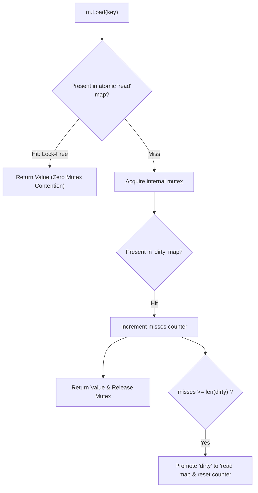

# sync.Map

## When you need this

Use `sync.Map` only for two specific concurrent map access patterns:
1. When a given key is written once but read many times (read-heavy caches).
2. When multiple goroutines read, write, and overwrite disjoint sets of keys (low contention on identical keys).

## When you do not need this

Do not use `sync.Map` as a general replacement for a standard Go map protected by `sync.RWMutex`. For typical mixed read/write workloads, `sync.RWMutex` with a regular map is significantly faster, uses less memory, and provides compile-time type safety.

## Prerequisites

- core-16-15

## Mental model

`sync.Map` is an adaptive concurrent map optimized for read operations without mutex contention. It internally maintains two data structures:
1. A **read-only map** (`read`) that supports lock-free atomic pointer loads.
2. A **dirty map** (`dirty`) that requires mutex locking for writes and inserts.
When cache misses on the read map cross a threshold, the dirty map is promoted to become the new read map.

## Visual model



## How it works

`sync.Map` avoids lock contention by using atomic operations (`atomic.Pointer`) on the read map. Keys are stored as `any` (requiring interface boxing). When a key is deleted, it is marked as expunged using an atomic tombstone rather than immediately removed, amortizing the cost of map reorganization until promotion.

## Go example

```go
package main

import (
	"fmt"
	"sync"
)

// Cache demonstrates type-safe encapsulation over sync.Map.
type Cache struct {
	m sync.Map
}

func (c *Cache) Set(key string, val int) {
	c.m.Store(key, val)
}

func (c *Cache) Get(key string) (int, bool) {
	v, ok := c.m.Load(key)
	if !ok {
		return 0, false
	}
	return v.(int), true
}

func (c *Cache) Delete(key string) {
	c.m.Delete(key)
}

// Demo demonstrates sync.Map and satisfies test requirements.
func Demo() string {
	cache := &Cache{}
	cache.Set("sessions", 42)
	val, ok := cache.Get("sessions")
	_ = val
	_ = ok
	return "sync.Map verified"
}

func main() {
	fmt.Println(Demo())
}
```

## Step-by-step execution

1. `m.Store(key, val)` stores the value, updating the dirty map under lock if not present in the read map.
2. `m.Load(key)` performs an atomic pointer load on the read map. If present, it returns with zero mutex locks.
3. If absent from the read map, it acquires the mutex and checks the dirty map.
4. Each miss on the read map increments an internal miss counter.
5. When misses equal the length of the dirty map, the dirty map is promoted to become the read map, resetting misses.

## Tradeoffs

- Advantage: Lock-Free Reads: Provides exceptional throughput under high-concurrency read-heavy workloads.
- Advantage: Stable Cache: Disjoint writes avoid lock contention across separate CPU cores.
- Disadvantage: Lost Type Safety: Storing and retrieving values requires `any` downcasts (`v.(int)`).
- Disadvantage: Slow Mixed Workloads: Frequent insertions of new keys degrade performance due to dirty map duplication.

## Common mistakes

| Mistake | Why it happens | Fix |
|---|---|---|
| Using `sync.Map` everywhere instead of `sync.RWMutex` | Assuming standard library means universally faster | Benchmark with real workloads; prefer `sync.RWMutex` for general use |
| Forgetting type assertions can panic | `sync.Map` stores `any` | Always check type assertion: `val, ok := v.(int)` |

## Debugging walkthrough

### Scenario: Performance drops significantly after switching from RWMutex to sync.Map

**Cause:** The workload frequently inserts brand-new keys that were never seen before, triggering constant mutex locks and copying between dirty and read maps.

**Fix:** Benchmark both implementations. If the workload is write-heavy or inserts dynamic ephemeral keys, revert to a regular Go map with `sync.RWMutex` or sharded map segments.

## Practice task

Benchmark a read-heavy workload (95% reads, 5% writes) comparing `sync.Map` against a `sync.RWMutex`-protected map across 100 concurrent goroutines. Report operations per second.

## Production notes

The Go runtime itself uses `sync.Map` internally for registration packages, reflection type caches, and global metrics registries where items are registered once during startup and read continuously.

## Related core lessons

- Module 15.15 — Demo preparation
- Module 17.15 — Demo preparation
