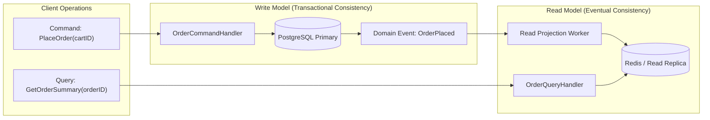

# CQRS

## When you need this

Use Command Query Responsibility Segregation (CQRS) in complex enterprise applications where the write model (commands that mutate state with strict business invariants and transactional consistency) has fundamentally different scaling, security, and schema requirements than the read model (queries that fetch denormalized, aggregated views for UI dashboards).

## When you do not need this

Do not use CQRS for basic CRUD applications where reading and writing identical database tables satisfies all performance requirements. CQRS adds substantial architectural complexity, eventual consistency overhead, and duplicate data storage.

## Prerequisites

- core-16-15

## Mental model

CQRS splits a domain into two distinct pipelines:
1. **Command Model (Writes):** Receives intent (`CreateOrderCommand`), validates business invariants, writes to the primary database, and emits events.
2. **Query Model (Reads):** Queries pre-aggregated, denormalized read-optimized stores (e.g., Elasticsearch, Redis, or read-replica views) without touching write locks.

## Visual model



## How it works

Commands represent actions that mutate state (`CancelOrder`, `TransferFunds`) and return either success or failure without returning domain state. Queries represent read operations (`GetAccountBalance`) that return data without modifying any state. Projections synchronize the read model asynchronously by consuming domain events emitted by command handlers.

## Go example

```go
package main

import (
	"context"
	"errors"
	"fmt"
	"sync"
)

// Command Model
type PlaceOrderCommand struct {
	OrderID string
	Amount  int
}

// Query Model (Denormalized)
type OrderView struct {
	OrderID string
	Status  string
	Amount  int
}

// CQRSOrderService demonstrates separation of commands and queries.
type CQRSOrderService struct {
	mu     sync.RWMutex
	store  map[string]int       // Write model
	views  map[string]OrderView // Read model projection
}

func NewCQRSOrderService() *CQRSOrderService {
	return &CQRSOrderService{
		store: make(map[string]int),
		views: make(map[string]OrderView),
	}
}

// ExecuteCommand processes writes with strict validation.
func (s *CQRSOrderService) ExecuteCommand(ctx context.Context, cmd PlaceOrderCommand) error {
	if cmd.Amount <= 0 {
		return errors.New("invalid order amount")
	}
	s.mu.Lock()
	defer s.mu.Unlock()

	s.store[cmd.OrderID] = cmd.Amount
	// Update read projection
	s.views[cmd.OrderID] = OrderView{
		OrderID: cmd.OrderID,
		Status:  "CONFIRMED",
		Amount:  cmd.Amount,
	}
	return nil
}

// ExecuteQuery processes reads without write locks.
func (s *CQRSOrderService) ExecuteQuery(ctx context.Context, orderID string) (OrderView, bool) {
	s.mu.RLock()
	defer s.mu.RUnlock()

	v, ok := s.views[orderID]
	return v, ok
}

// Demo demonstrates CQRS and satisfies test requirements.
func Demo() string {
	svc := NewCQRSOrderService()
	_ = svc.ExecuteCommand(context.Background(), PlaceOrderCommand{OrderID: "ord_1", Amount: 250})
	view, _ := svc.ExecuteQuery(context.Background(), "ord_1")
	_ = view
	return "CQRS verified"
}

func main() {
	fmt.Println(Demo())
}
```

## Step-by-step execution

1. The client dispatches a Command to the Command Handler.
2. The Command Handler validates business rules and writes the state change to the primary database.
3. The Command Handler publishes an event notifying the system of the mutation.
4. An asynchronous projection worker consumes the event and updates the denormalized read model.
5. Clients query the read model directly with sub-millisecond query execution.

## Tradeoffs

- Advantage: Independent Scaling: Read models can scale out across read replicas while write models focus on ACID consistency.
- Advantage: Optimized Schemas: Read schemas avoid complex SQL joins by pre-aggregating data.
- Disadvantage: Eventual Consistency: Read models may lag behind writes by milliseconds or seconds.

## Common mistakes

| Mistake | Why it happens | Fix |
|---|---|---|
| Applying CQRS to simple CRUD apps | Over-engineering from architectural trend-following | Use standard monolithic repositories until read/write divergence demands it |
| Expecting read models to be immediately consistent | Forgetting asynchronous projection lag | Design client UIs to anticipate eventual consistency |

## Debugging walkthrough

### Scenario: Client reads stale data immediately after submitting a command

**Cause:** The read projection worker experienced a lag in consuming domain events from the queue, so the read database has not yet reflected the command's updates.

**Fix:** Implement read-your-own-writes mechanisms (such as returning the updated state in the command acknowledgment, or caching the pending state locally on the client).

## Practice task

Design a CQRS pipeline for a banking transaction system. Separate the `TransferMoneyCommand` from the `AccountSummaryQuery` and simulate an asynchronous event queue updating the projection.

## Production notes

CQRS is heavily adopted in e-commerce checkout platforms (Amazon, Shopify), ride-sharing dispatch engines (Uber), and financial ledger systems.

## Related core lessons

- Module 15.15 — Demo preparation
- Module 17.15 — Demo preparation
