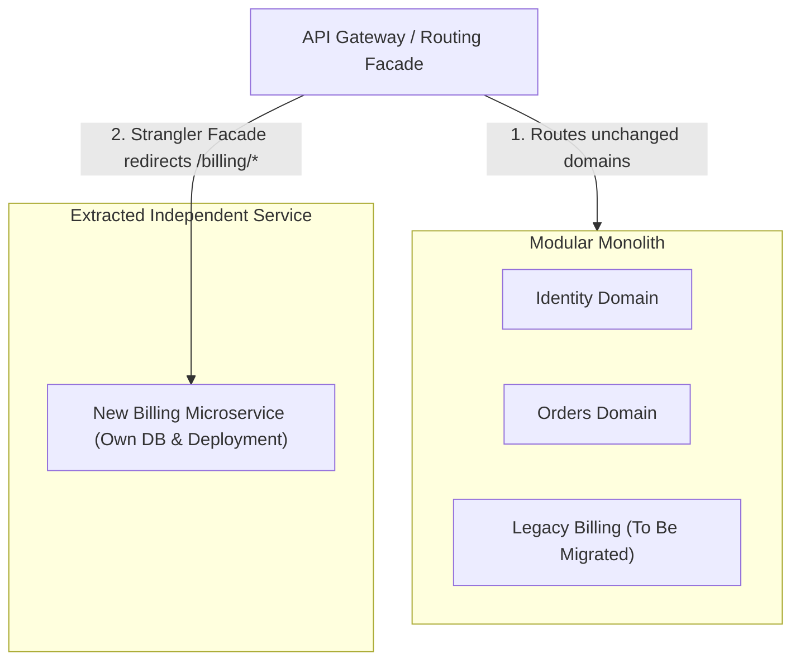

# Microservice Splitting

## When you need this

Use microservice splitting when an existing monolithic Go application reaches organizational or operational limits: separate teams need independent deployment cadences, specific components require radically different hardware scaling profiles (e.g. CPU-heavy video encoding vs I/O-heavy API), or strict data isolation compliance requires distinct boundaries.

## When you do not need this

Do not split a monolith early in a product's lifecycle or when a single team maintains the system. Splitting prematurely trades simple in-memory function calls for network latency, distributed failures, eventual consistency bugs, and high DevOps maintenance.

## Prerequisites

- core-16-15

## Mental model

Service decomposition should follow the **Strangler Fig Pattern**: instead of rewriting the entire system from scratch (the second-system syndrome), incrementally extract one cohesive business domain at a time behind a routing facade until the new microservice owns its domain completely.

## Visual model



## How it works

Splitting begins at the database level: each service must strictly own its own private database schema. No external service is allowed to query another service's tables directly. Communication occurs exclusively through defined network APIs (gRPC/REST) or asynchronous domain events.

## Go example

```go
package main

import (
	"context"
	"fmt"
)

// ServiceRouter simulates the Strangler Fig routing facade.
type ServiceRouter struct {
	routes map[string]string // pathPrefix -> destination ("monolith" vs "extracted-service")
}

func NewServiceRouter() *ServiceRouter {
	return &ServiceRouter{
		routes: map[string]string{
			"/api/v1/users":  "monolith",
			"/api/v1/orders": "monolith",
			"/api/v1/billing": "extracted-billing-svc", // Strangled domain
		},
	}
}

func (r *ServiceRouter) Route(path string) string {
	dest, ok := r.routes[path]
	if !ok {
		return "monolith"
	}
	return dest
}

// Demo demonstrates Microservice splitting and satisfies test requirements.
func Demo() string {
	router := NewServiceRouter()
	dest := router.Route("/api/v1/billing")
	_ = dest
	_ = context.Background()
	return "Microservice splitting verified"
}

func main() {
	fmt.Println(Demo())
}
```

## Step-by-step execution

1. Identify a cohesive domain with loose coupling to other domains (e.g. Notification or Billing).
2. Establish internal interface boundaries within the monolith code first.
3. Extract the domain's database tables into a separate database instance.
4. Deploy the new microservice running independently.
5. Update the API Gateway to route traffic for that domain to the new microservice.
6. Delete the deprecated code from the monolith.

## Tradeoffs

- Advantage: Team Autonomy: Teams ship, scale, and maintain their own services without deployment train contention.
- Advantage: Targeted Scaling: Allocate CPU and memory specifically where needed without scaling the entire monolith.
- Disadvantage: Distributed Systems Complexity: Introduces network latency, partial failures, distributed tracing needs, and loss of ACID transactions across domains.

## Common mistakes

| Mistake | Why it happens | Fix |
|---|---|---|
| Splitting services while sharing a single central database | Creating a distributed monolith with shared schema coupling | Every microservice must strictly own its private database |
| Making circular synchronous HTTP calls between microservices | Creating cascading failure loops | Use event-driven messaging or hierarchical service dependencies |

## Debugging walkthrough

### Scenario: Splitting causes distributed transactions to fail halfway

**Cause:** The monolith relied on a single PostgreSQL `BEGIN ... COMMIT` transaction across orders and payments, which is impossible across separate databases.

**Fix:** Implement the Saga Pattern or Outbox Pattern to coordinate state changes asynchronously with compensating transactions upon failure.

## Practice task

Design an event-driven architecture diagram showing how an `OrderService` and `InventoryService` coordinate inventory reservation using an outbox table and message broker instead of synchronous HTTP calls.

## Production notes

Companies that successfully split monoliths (such as Uber, Netflix, and Monzo) invest heavily in platform infrastructure: service meshes, distributed tracing, automated schema generation, and contract testing.

## Related core lessons

- Module 15.15 — Demo preparation
- Module 17.15 — Demo preparation
