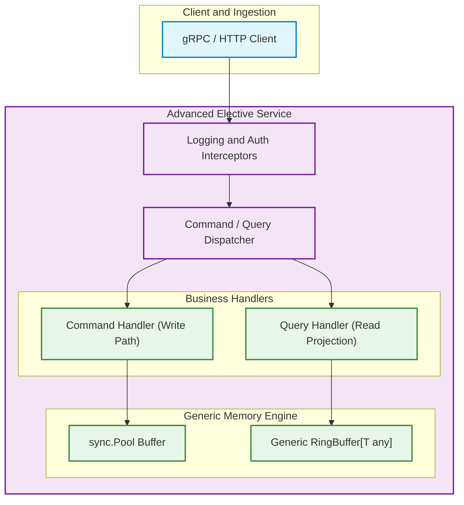

# Project: Advanced Electives Capstone

> **Track:** Independent Advanced Electives (Module 17)  
> **Status:** Released  
> **Difficulty:** Advanced  
> **Estimated Effort:** 10–15 hours  

---

## 1. Project Mission

Synthesize and apply advanced Go concepts explored across Module 17 by building a standalone, production-grade service or systems utility. You will choose one of three specialized engineering tracks:

1. **High-Performance Concurrent Memory Buffer (Generics + `sync.Pool`)**: A generic, zero-allocation circular ring-buffer or object pool with thread-safe eviction and microsecond benchmarks.
2. **Streaming RPC Microservice (`gRPC` + Protobuf + Interceptors)**: A bi-directional streaming telemetry collector with auth interceptors, structured error mapping, and graceful teardown.
3. **Event-Sourced Task Engine (`CQRS` + Custom Build Tags)**: A decoupled command-query engine utilizing separate read/write data paths and environment-specific build tags (`//go:build`).

---

## 2. Architecture and Design Requirements



---

## 3. Required Deliverables

1. **Executable Go Service**: Clean idiomatic Go code organized under standard conventions (`cmd/`, `internal/`, `pkg/`).
2. **Benchmark & Test Suite**: Comprehensive unit tests achieving >=80% coverage on core packages, race detector compliance (`go test -race ./...`), and Go benchmarks (`go test -bench=. -benchmem`).
3. **Architecture Decision Record (ADR)**: A markdown technical design document detailing:
   - The selected elective topics and problem statement.
   - Mechanical trade-offs (e.g. GC pressure vs `sync.Pool` complexity, gRPC streaming vs REST polling).
   - Observable performance characteristics and failure modes.

---

## 4. Evaluation Rubric

| Criterion | Weight | Description |
| :--- | :---: | :--- |
| **Technical Depth** | **35%** | Project demonstrates advanced Go mechanisms from Module 17 (type sets, pool reuse, stream lifecycle, or CQRS) with mechanical correctness. |
| **Code Quality & Idioms** | **25%** | Clear package boundaries, context propagation, explicit error handling without panics, and zero magic abstractions. |
| **Verification & Proof** | **25%** | Working test suite with zero race conditions, passing benchmarks demonstrating memory efficiency, and deterministic verification. |
| **Design & Documentation** | **15%** | Architectural defense, clear README setup instructions, and structured explanation of design trade-offs. |

---

## 5. Verification Commands

Run the local verification suite from the project directory:

```bash
# 1. Run unit tests with race detection
go test -v -race ./...

# 2. Run memory allocation benchmarks
go test -bench=. -benchmem ./...

# 3. Verify static analysis
go vet ./...
```
