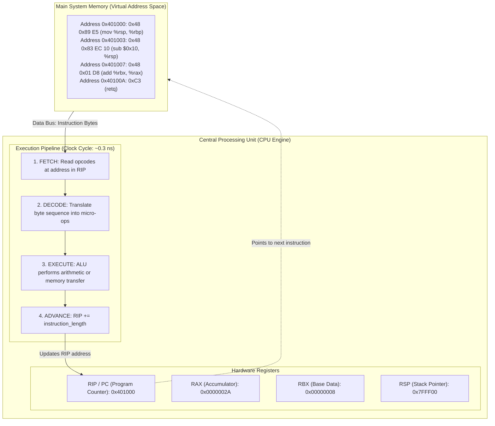

# Source code, executable, and process

## Learning objective

Trace how the CPU fetches, decodes, and executes compiled machine instructions from system memory.

## Why this matters

Writing code is only half the engineering equation; the other half is understanding what the physical machine actually does with that code. When developers do not understand the CPU instruction cycle and memory execution, mysterious bugs like segmentation faults, stack overflows, CPU cache thrashing, and process deadlocks feel like arbitrary computer tantrums. Mastering the journey from text to CPU cycles replaces superstition with mechanical sympathy.

## Mental model

The computer physically runs on the **Von Neumann Architecture**, composed of three collaborating subsystems connected by high-speed electronic buses:
1. **System Memory (RAM):** A massive, linear array of byte cells (each with a numerical address, e.g., `0x0000` to `0xFFFF...`). Both compiled program instructions and application data reside here in partitioned segments.
2. **The System Bus:** The electronic highway that moves data, addresses, and control signals between RAM and the processor.
3. **The Central Processing Unit (CPU):** The physical silicon engine that continuously executes instructions through an unbroken rhythm called the **Instruction Cycle**:
   - **Fetch:** The CPU reads the byte sequence located at the memory address stored in the **Instruction Pointer / Program Counter (`RIP` / `PC`)** register.
   - **Decode:** The CPU's Control Unit decodes the binary opcode (e.g., `0x48 0x89` = `MOV`) to determine which electronic circuits must activate.
   - **Execute:** The **Arithmetic Logic Unit (ALU)** executes mathematical or logical calculations, or data is moved between registers.
   - **Advance:** The Instruction Pointer register increments to point to the immediate next memory byte, unless a branch (`JMP`, `CALL`, `RET`) forces `RIP` to a new target address.

## Visual model



## Core idea

Computers do not execute Go code, Python code, or shell scripts directly. The Go compiler (`gc`) translates high-level semantic statements into raw, architecture-specific byte sequences (machine opcodes). When the OS loader executes your program, it copies those opcode bytes into executable memory pages (`.text` segment) and directs the CPU's `RIP` register to the entry point. The hardware CPU then relentlessly cycles through Fetch-Decode-Execute billions of times per second until the process terminates.

## Under the hood

Inside the CPU, timing is governed by an electronic quartz clock generator. A modern 3.5 GHz processor ticks 3.5 billion times per second, meaning one clock cycle takes approximately **0.28 nanoseconds**.

| Operation / Memory Level | Latency (Clock Cycles) | Real Time (Approximate) | Physical Reality |
|---|---|---|---|
| **CPU Register Access (`RAX`, `RIP`)** | 1 cycle | ~0.3 ns | Internal flip-flop silicon gates |
| **L1 CPU Cache Hit** | 4–5 cycles | ~1–1.5 ns | On-die static RAM (SRAM) next to core |
| **L2 CPU Cache Hit** | 12–14 cycles | ~3–4 ns | On-die SRAM dedicated to core |
| **L3 Shared Cache Hit** | 30–50 cycles | ~10–15 ns | On-die SRAM shared across cores |
| **Main System RAM Access** | 150–250 cycles | ~50–80 ns | Electronic bus transfer to external DRAM chips |
| **NVMe SSD Storage Read** | 100,000+ cycles | ~30–50 µs | Flash memory controller read |

Because accessing system RAM is roughly 200 times slower than reading a register, CPUs employ hardware caches and instruction prefetchers to predict which instructions the `RIP` will need next, pre-loading them into L1 cache before the decode unit even requests them.

## How Go uses it

Go compiles directly to native machine instructions rather than running inside an interpreted virtual machine (unlike Java or Python). When you run:
```bash
go build -o app .
```
You can inspect the literal assembly instructions and machine bytes that the CPU will execute using Go's built-in disassembler:
```bash
go tool objdump -s main.main app
```
Each line of Go is mapped to corresponding assembly mnemonics (`MOVQ`, `ADDQ`, `CALL`, `RET`) and their underlying hexadecimal machine opcodes. The Go runtime itself manages system threads and schedules goroutines by manipulating thread registers and call stacks directly at the machine instruction layer.

## Go example

The example program demonstrates the mechanical relationship between high-level Go statements, process memory addresses, CPU architecture identification, and sequential execution flow:

```go
package main

import (
	"fmt"
	"os"
	"runtime"
	"time"
)

// InstructionStep represents a CPU-level Fetch-Decode-Execute operation.
type InstructionStep struct {
	Address     string
	Opcodes     string
	Assembly    string
	Description string
}

func main() {
	fmt.Println("=== CPU Architecture & Execution Environment ===")
	fmt.Printf("Operating System: %s\n", runtime.GOOS)
	fmt.Printf("CPU Architecture: %s\n", runtime.GOARCH)
	fmt.Printf("Logical CPU Cores: %d\n", runtime.NumCPU())
	fmt.Printf("Current Process PID: %d\n\n", os.Getpid())

	// Simulated trace of compiled machine instructions for a simple addition:
	// Go: a := 42; b := 8; return a + b
	trace := []InstructionStep{
		{
			Address:     "0x0045A120",
			Opcodes:     "48 c7 c0 2a 00 00 00",
			Assembly:    "MOVQ $0x2a, %rax",
			Description: "Load immediate integer 42 into register RAX",
		},
		{
			Address:     "0x0045A127",
			Opcodes:     "48 c7 c3 08 00 00 00",
			Assembly:    "MOVQ $0x08, %rbx",
			Description: "Load immediate integer 8 into register RBX",
		},
		{
			Address:     "0x0045A12E",
			Opcodes:     "48 01 d8",
			Assembly:    "ADDQ %rbx, %rax",
			Description: "ALU adds RAX + RBX; result (50) stored in RAX",
		},
		{
			Address:     "0x0045A131",
			Opcodes:     "c3",
			Assembly:    "RETQ",
			Description: "Pop return address from stack into RIP; jump to caller",
		},
	}

	fmt.Println("=== Tracing CPU Fetch-Decode-Execute Cycle ===")
	for i, step := range trace {
		fmt.Printf("[Step %d] PC/RIP -> %s\n", i+1, step.Address)
		fmt.Printf("   Opcodes (Raw Bytes): %s\n", step.Opcodes)
		fmt.Printf("   Instruction:         %-20s\n", step.Assembly)
		fmt.Printf("   Action:              %s\n\n", step.Description)
		time.Sleep(50 * time.Millisecond)
	}

	fmt.Println("Conclusion: The CPU executes byte sequences by sequentially bumping the RIP register.")
}
```

## Step-by-step execution

1. **Compilation Phase:** The Go compiler compiles `main.go`, generating machine code bytes and packing them into an executable container (ELF on Linux, Mach-O on macOS, PE on Windows).
2. **OS Loader Phase:** When you invoke the binary from your shell, the kernel executes `execve` (Linux) or `CreateProcess` (Windows), allocating private virtual memory pages and mapping the binary's `.text` section into executable RAM.
3. **CPU Initialization:** The OS kernel loads the virtual address of the program's entry point into the CPU's `RIP` (Instruction Pointer) register and transfers hardware control to the CPU core.
4. **Fetch Phase:** The CPU places the memory address currently in `RIP` onto the memory address bus and fetches the raw machine instruction bytes (`0x48 0xC7 ...`) into its internal instruction cache.
5. **Decode Phase:** The CPU's instruction decoder interprets the byte stream, identifying the instruction operation code (opcode) and operands.
6. **Execute Phase:** The ALU performs the operation (arithmetic, logical comparison, or register transfer). If the operation requires writing data back to RAM or reading from memory, the address bus and data bus are engaged.
7. **Advance Phase:** The CPU increments `RIP` by the length of the completed instruction, readying the hardware for the next clock cycle.

## Common mistakes

| Mistake | Why it happens | Fix |
|---|---|---|
| Thinking the CPU executes source code directly | Beginners confuse high-level languages with hardware execution | Understand that the CPU only understands raw binary numbers (opcodes); compilers exist solely to bridge this gap |
| Believing memory access is instant | Programming languages treat all variables identically | Understand the memory hierarchy: registers take <1ns, while RAM takes ~80ns (hundreds of wasted clock cycles) |
| Confusing the Instruction Pointer with data pointers | Both contain memory addresses | Understand that `RIP` strictly controls *which instruction executes next*, whereas data pointers reference data values in RAM |

## Debugging walkthrough

**Scenario: A program crashes with a "Segmentation Fault: Invalid Memory Address Dereference" (SIGSEGV).**
- **Cause:** The CPU decoded an instruction attempting to read or write to a memory address that does not exist in the process's virtual memory page table (such as address `0x0` / nil pointer).
- **Diagnosis:** The OS Memory Management Unit (MMU) detects that the address sent over the bus is unmapped or protected, raises a hardware exception, and interrupts the CPU. The kernel catches this exception and sends signal 11 (`SIGSEGV`) to terminate the offending process.
- **Resolution:** Inspect the stack trace to find which variable contained `nil` (zero value pointer) before dereferencing it, and add explicit nil validation guards.

**Scenario: A program locks up at 100% CPU usage without printing or terminating.**
- **Cause:** An infinite loop (`for {}` without an exit condition) is causing the CPU to repeatedly fetch, decode, and execute the same branch instruction over and over at 3.5 billion cycles per second.
- **Diagnosis:** Run `top` (Linux/macOS) or Task Manager (Windows) to identify the runaway PID consuming an entire CPU core.
- **Resolution:** Add terminating conditions, loop timeouts, or blocking I/O calls so the process releases the CPU to the OS scheduler.

## Production notes

Modern high-performance backend engineering demands mechanical sympathy. When optimizing high-throughput Go microservices handling 100,000+ requests per second, CPU cache misses and instruction pipeline stalls are primary bottlenecks. Idiomatic Go emphasizes contiguous memory layouts (such as slices of structs rather than slices of pointers) specifically to ensure CPU hardware prefetchers can load consecutive cache lines into L1 cache ahead of time, eliminating RAM bus stalls.

## Performance implications

- Branch prediction misses can stall the CPU pipeline for 15–20 cycles while speculative instructions are flushed.
- Sequential memory iteration is up to 50x faster than random memory pointer chasing due to CPU hardware prefetching.
- Tight loops that fit entirely within the CPU's L1 Instruction Cache (L1i, typically 32 KB) run with zero instruction fetch latency.

## Tests / verification

1. Run the example program: `go run ./curriculum/modules/01-computers-terminal-git-web/02-source-code-executable-and-process`.
2. Inspect the printed CPU architecture, logical core count, and process PID.
3. Build a binary of the example: `go build -o test_bin ./curriculum/modules/01-computers-terminal-git-web/02-source-code-executable-and-process`.
4. Inspect the compiled machine instructions using the Go disassembler:
   - On Linux/macOS: `go tool objdump -s main.main test_bin | head -n 25`
   - On Windows PowerShell: `go tool objdump -s main.main test_bin.exe | Select-Object -First 25`
5. Observe how every line of Go code maps directly to machine assembly instructions (`TEXT`, `SUBQ`, `MOVQ`, `CALL`, `RET`).

## Review questions

1. What is the fundamental difference between system RAM and CPU registers?
2. Explain what happens during each of the four phases of the CPU instruction cycle (Fetch, Decode, Execute, Advance).
3. If a CPU core runs at 3.0 GHz, approximately how many nanoseconds does a single clock cycle take?
4. What role does the `RIP` (Instruction Pointer) register play, and what causes it to jump rather than increment sequentially?
5. Why is reading a variable from system RAM significantly slower than accessing a variable already held in a CPU register?

## NEXT UP

[Lesson 03: Files, bytes, directories, and paths](../03-files-bytes-directories-and-paths/README.md)
