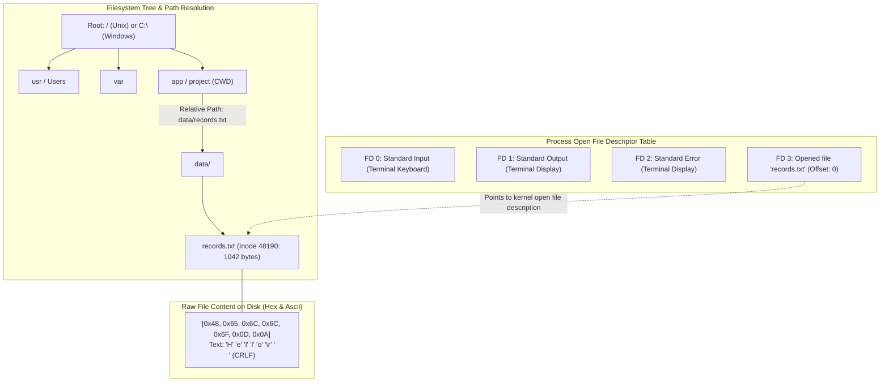

# Files, bytes, directories, and paths

## Learning objective

Inspect filesystem hierarchies, file descriptors, binary byte representations, and absolute vs relative paths.

## Why this matters

Files are the fundamental storage abstraction in every operating system. Without understanding how paths resolve, how bytes relate to raw disk sectors, how line endings differ across platforms, and how file descriptors connect processes to streams, every file operation feels fragile and unpredictable.

## Mental model

At the physical hardware layer, storage drives only store raw 8-bit bytes (0–255) grouped into sectors. The operating system overlays this raw storage with four fundamental abstractions:
1. **Files (Named Byte Streams):** An arbitrary sequence of bytes associated with metadata (inode or MFT record, size, permissions, timestamps).
2. **Directories (Name-to-Location Tables):** Specialized files whose content is a mapping of human-readable file names to filesystem node identifiers.
3. **Paths (Navigation Coordinates):** Absolute paths anchor navigation to the root (`/` on Unix, `C:\` on Windows). Relative paths resolve coordinates starting from the calling process's Current Working Directory (CWD).
4. **File Descriptors (Kernel Stream Handles):** Non-negative integers assigned by the kernel to represent open I/O resources (file, socket, pipe). By default, every process starts with three: `0` (stdin), `1` (stdout), and `2` (stderr).

## Visual model



## Core idea

Without a filesystem, every program would need to manage raw disk sectors — an impossible burden. Files, directories, paths, and file descriptors give developers a uniform, tree-based abstraction that works across programming languages and operating systems.

## Under the hood

### 1. Inodes and Directory Tables
On Linux, ext4 stores files in blocks (default 4 KB). Each file has an inode (index node) storing 15 block pointers (direct, indirect, doubly indirect, triply indirect) plus metadata. A directory does not physically contain file contents; it is simply a list of `(name, inode_number)` pairs.

### 2. Line Ending Realities (`CRLF` vs `LF`)
Text files are simply sequences of byte numbers. How a newline is represented differs by operating system:
- **POSIX (Linux, macOS):** Line Feed (`\n`, ASCII `10`, hex `0x0A`).
- **Windows:** Carriage Return + Line Feed (`\r\n`, ASCII `13 10`, hex `0x0D 0x0A`).

When a shell script or Go file created on Windows with `CRLF` is executed on Linux or inside a Docker container, the shell attempts to parse the invisible `\r` character as part of the command or interpreter name, resulting in the infamous error:
```bash
/bin/bash^M: bad interpreter: No such file or directory
```
To prevent this, Git can normalize line endings automatically:
```bash
# On Windows: check out CRLF, commit LF
git config --global core.autocrlf true

# On Linux / macOS: commit LF only
git config --global core.autocrlf input
```

### 3. File Permissions
POSIX filesystems protect files using 9 permission bits grouped into three sets: Owner (`u`), Group (`g`), and Others (`o`). Each set has Read (`r` = 4), Write (`w` = 2), and Execute (`x` = 1):
- `0755` (`rwxr-xr-x`): Executable binary or directory (owner can edit; others can read and execute).
- `0644` (`rw-r--r--`): Standard document or source file (owner can edit; others read only).
- `0600` (`rw-------`): Private key or secret configuration (owner read/write only; all others denied).

## How Go uses it

Go's `os` and `path/filepath` packages provide cross-platform filesystem access.
- `filepath.Join("data", "records.txt")` uses `/` on Linux and `\` on Windows automatically.
- `os.OpenFile(path, os.O_RDWR|os.O_CREATE, 0644)` requests the OS to allocate a file descriptor.
- `os.Stdin`, `os.Stdout`, and `os.Stderr` are pre-initialized `*os.File` pointers wrapping file descriptors 0, 1, and 2.

## Go example

The example demonstrates creating files, inspecting raw byte representations (including line ending bytes), reading metadata, opening standard streams, and using cross-platform path utilities:

```go
package main

import (
	"bytes"
	"fmt"
	"os"
	"path/filepath"
)

// FileInfo holds metadata and content for a file.
type FileInfo struct {
	Path        string
	Size        int64
	IsDir       bool
	Content     string
	RawBytes    []byte
	Permissions os.FileMode
}

// CreateFile writes bytes to disk, creating parent directories if necessary.
func CreateFile(path string, content []byte, perm os.FileMode) error {
	dir := filepath.Dir(path)
	if err := os.MkdirAll(dir, 0755); err != nil {
		return fmt.Errorf("mkdir failed: %w", err)
	}
	if err := os.WriteFile(path, content, perm); err != nil {
		return fmt.Errorf("write file failed: %w", err)
	}
	return nil
}

// ReadFile retrieves content, metadata, and raw byte slice for a given path.
func ReadFile(path string) (*FileInfo, error) {
	stat, err := os.Stat(path)
	if err != nil {
		return nil, fmt.Errorf("stat failed: %w", err)
	}
	data, err := os.ReadFile(path)
	if err != nil {
		return nil, fmt.Errorf("read failed: %w", err)
	}
	return &FileInfo{
		Path:        path,
		Size:        stat.Size(),
		IsDir:       stat.IsDir(),
		Content:     string(data),
		RawBytes:    data,
		Permissions: stat.Mode().Perm(),
	}, nil
}

func main() {
	tempDir, err := os.MkdirTemp("", "the-go-engineer-file-io-*")
	if err != nil {
		fmt.Fprintf(os.Stderr, "failed to create temp dir: %v\n", err)
		os.Exit(1)
	}
	defer os.RemoveAll(tempDir) // cleanup on exit

	samplePath := filepath.Join(tempDir, "data", "records.txt")
	// Notice explicit CRLF vs LF:
	sampleContent := []byte("Hello, byte-level file I/O!\r\nLine 2: 42 bytes.\n")

	if err := CreateFile(samplePath, sampleContent, 0644); err != nil {
		fmt.Fprintf(os.Stderr, "failed to create file: %v\n", err)
		os.Exit(1)
	}

	info, err := ReadFile(samplePath)
	if err != nil {
		fmt.Fprintf(os.Stderr, "failed to read file: %v\n", err)
		os.Exit(1)
	}

	fmt.Println("=== File Metadata and Permissions ===")
	fmt.Printf("Path:        %s\n", info.Path)
	fmt.Printf("Size:        %d bytes\n", info.Size)
	fmt.Printf("Permissions: %o (%s)\n", info.Permissions, info.Permissions)
	fmt.Printf("Is Dir:      %t\n", info.IsDir)

	fmt.Println("\n=== Byte Inspection & Line Endings ===")
	fmt.Printf("Has Windows CRLF (\\r\\n): %t\n", bytes.Contains(info.RawBytes, []byte("\r\n")))
	fmt.Printf("Has Unix LF (\\n):         %t\n", bytes.Contains(info.RawBytes, []byte("\n")))
	fmt.Printf("First 10 Bytes (Hex):     % x\n", info.RawBytes[:10])

	fmt.Println("\n=== Standard Process File Descriptors ===")
	fmt.Printf("os.Stdin.Fd():  %d\n", os.Stdin.Fd())
	fmt.Printf("os.Stdout.Fd(): %d\n", os.Stdout.Fd())
	fmt.Printf("os.Stderr.Fd(): %d\n", os.Stderr.Fd())

	fmt.Println("\n=== Cross-Platform Path Manipulation ===")
	abs, _ := filepath.Abs(samplePath)
	fmt.Printf("filepath.Abs:  %s\n", abs)
	fmt.Printf("filepath.Base: %s\n", filepath.Base(samplePath))
	fmt.Printf("filepath.Dir:  %s\n", filepath.Dir(samplePath))
	fmt.Printf("filepath.Ext:  %s\n", filepath.Ext(samplePath))
}
```

## Step-by-step execution

1. The OS mounts a filesystem (NTFS, ext4, APFS) that organizes storage into a tree of directories and files.
2. A file is a named sequence of bytes stored in fixed-size blocks on disk, tracked by an inode or MFT record containing metadata (size, permissions, timestamps).
3. A directory is a special file that maps human-readable names to inode numbers.
4. When a program opens a file with `os.Open()`, the kernel verifies permissions, allocates an entry in the process's file descriptor table (e.g., FD 3), and initializes a read offset.
5. `CreateFile` ensures parent directories exist via `os.MkdirAll`, then writes the byte array to disk with mode `0644`.
6. `ReadFile` uses `os.ReadFile` and `os.Stat` to retrieve size, permissions, and raw byte content.
7. The program inspects raw hex byte values to verify presence of `0x0D 0x0A` (`\r\n`) vs `0x0A` (`\n`).
8. The program verifies that standard stream pointers `os.Stdin`, `os.Stdout`, and `os.Stderr` map directly to kernel file descriptors 0, 1, and 2.

## Common mistakes

| Mistake | Why it happens | Fix |
|---|---|---|
| Hardcoding path separators (`/` or `\`) | Assuming all systems use Unix slashes or Windows backslashes | Always use `filepath.Join` to construct cross-platform filesystem paths |
| Committing Windows `CRLF` scripts to Git | Text editors on Windows default to `\r\n` | Set `git config core.autocrlf` or use `.gitattributes` to force `LF` on scripts |
| Forgetting to close opened file handles | OS limits the number of concurrent open file descriptors per process | Always use `defer file.Close()` immediately after checking `err == nil` on file open |
| Assuming a file's extension dictates its content | Renaming `data.csv` to `data.png` does not change the file's bytes | Validate magic byte headers (e.g., first 4 bytes) rather than relying on file extensions |

## Debugging walkthrough

**Scenario: A shell script runs cleanly on Windows Git Bash but fails inside an Alpine Linux container with `^M: bad interpreter: No such file or directory`.**
- **Cause:** The script contains Windows carriage returns (`\r\n`). Linux interprets `\r` as a literal character in the shebang path `#!/bin/sh\r`.
- **Diagnosis:** Run `file script.sh` or `cat -v script.sh`. If it reports `ASCII text, with CRLF line terminators` or displays `^M` at the end of each line, the line endings are Windows style.
- **Resolution:** Convert the file to Unix line endings using `dos2unix script.sh` or in Git with `git add --renormalize .`.

**Scenario: A long-running Go service crashes with "too many open files" after running for several hours.**
- **Cause:** The application opens files or network sockets in a loop without closing them, leaking file descriptors until the OS `ulimit -n` process quota is exhausted.
- **Diagnosis:** Run `lsof -p <PID>` (Linux/macOS) or use Handle (Windows Sysinternals) to count open descriptors.
- **Resolution:** Audit file opening code and ensure every `os.Open` or `net.Dial` has a corresponding `.Close()` call.

## Production notes

In high-concurrency microservices, improper file descriptor management and path resolution are major causes of production outages. Containerized microservices (Docker, Kubernetes) run Linux kernels, meaning any Windows CRLF line ending that sneaks into a deployment script or configuration template will break container boot. Automate line ending enforcement in pre-commit hooks and CI pipelines.

## Performance implications

- Small unbuffered reads (1 byte at a time) trigger thousands of kernel syscalls; reading in 32 KB or 64 KB buffers is up to 100x faster.
- Deep directory path traversal requires multiple inode lookups from disk or page cache.
- Modern SSDs deliver high random read throughput, but unbuffered sequential writes still benefit significantly from kernel write-back caching.

## Tests / verification

1. Create a directory and file using your terminal:
   - Bash: `mkdir -p testdir && echo -e "hello\r\nworld" > testdir/hello.txt`
   - PowerShell: `New-Item -ItemType Directory -Path testdir -Force; "hello`r`nworld" | Out-File -FilePath testdir/hello.txt -Encoding ascii`
2. Inspect the file metadata with `ls -la testdir` (Linux/macOS) or `Get-ChildItem testdir` (PowerShell). Note the byte size.
3. Inspect the raw bytes to confirm line ending representation:
   - On Linux/macOS: `xxd testdir/hello.txt` or `hexdump -C testdir/hello.txt`
   - On Windows PowerShell: `Format-Hex testdir/hello.txt`
4. Confirm whether you see `0d 0a` (`\r\n`) or `0a` (`\n`).

## Review questions

1. What is the difference between an absolute path and a relative path, and how does the OS resolve a relative path?
2. What are file descriptors 0, 1, and 2, and what standard streams do they correspond to?
3. What is the difference between Windows `CRLF` and Unix `LF` line endings in terms of raw hexadecimal byte values?
4. Why does a bash script with `CRLF` line endings fail to execute on Linux with a `^M: bad interpreter` error?
5. What does file permission octal `0755` represent, and how do permissions differ between owner, group, and others?

## NEXT UP

[Lesson 04: Terminal basics](../04-terminal-basics/README.md)
