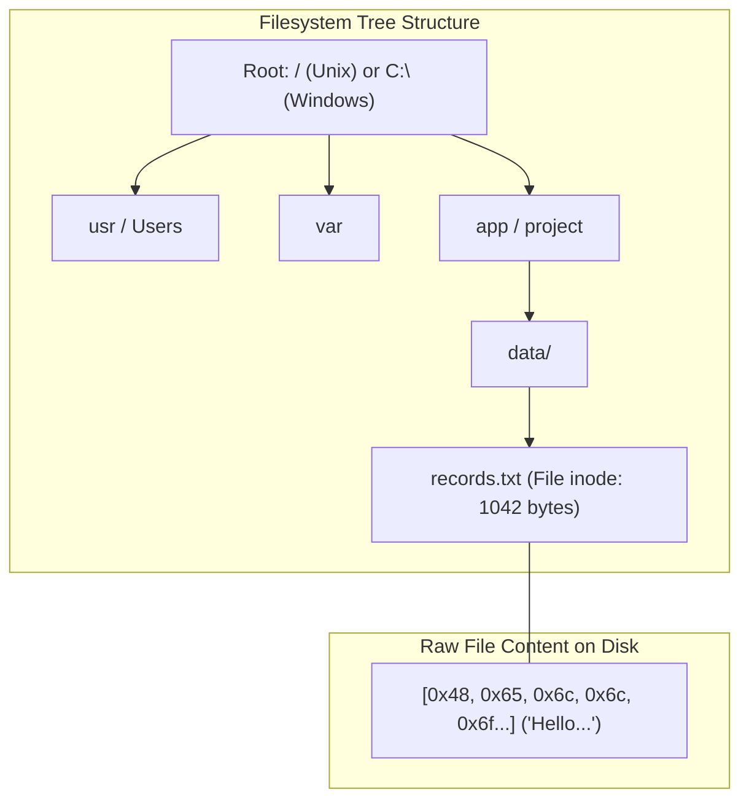

# Files, bytes, directories, and paths

## Learning objective

Inspect filesystem hierarchies, file descriptors, binary byte representations, and absolute vs relative paths.

## Why this matters

Files are the fundamental storage abstraction in every OS. Without understanding how paths resolve, how bytes relate to content, and how directories organize data, every file operation feels fragile and unpredictable.

## Mental model

At the physical hardware layer, storage drives only store raw 8-bit bytes (0–255) grouped into sectors. The operating system filesystem overlays this raw storage with three fundamental abstractions:
- **Files (Named Byte Streams):** An arbitrary sequence of bytes associated with metadata (inode/file record, size, permissions, timestamps).
- **Directories (Name-to-Location Tables):** Specialized files whose content is a mapping of human-readable file names to filesystem node identifiers.
- **Paths (Navigation Coordinates):** Absolute paths anchor navigation to the root (`/` on Unix, `C:\` on Windows). Relative paths resolve coordinates starting from the calling process's current working directory (CWD).

## Visual model



## Core idea

Without a filesystem, every program would need to manage raw disk sectors — an impossible burden. Files, directories, and paths give developers a simple tree-based abstraction that works across programming languages and operating systems.

## Under the hood

On Linux, ext4 stores files in blocks (default 4 KB). Each file's inode (index node) stores 15 block pointers: 12 direct, 1 indirect, 1 doubly indirect, 1 triply indirect — supporting files up to 16 TB. NTFS uses MFT (Master File Table) entries instead of inodes. All filesystems use B-trees or similar structures for directory lookups.

## How Go uses it

Go's `os` and `path/filepath` packages provide cross-platform filesystem access. `os.Open`, `os.ReadFile`, `os.WriteFile`, and `filepath.Join` abstract over OS differences. Go's `embed` package even allows embedding files directly into the binary at compile time.

## Go example

The example defines a `FileInfo` struct to hold path, size, directory flag, and content. Two functions — `CreateFile` and `ReadFile` — demonstrate writing bytes to disk and reading them back. `main()` creates a file, prints its metadata and content, then cleans up. Path manipulation functions like `filepath.Join`, `filepath.Abs`, `filepath.Base`, `filepath.Dir`, and `filepath.Ext` are used to inspect the path.

```go
package main

import (
	"fmt"
	"os"
	"path/filepath"
)

// FileInfo holds metadata and content for a file.
type FileInfo struct {
	Path    string
	Size    int64
	IsDir   bool
	Content string
}

// CreateFile writes bytes to disk, creating parent directories if necessary.
func CreateFile(path string, content []byte) error {
	dir := filepath.Dir(path)
	if err := os.MkdirAll(dir, 0755); err != nil {
		return fmt.Errorf("mkdir failed: %w", err)
	}
	if err := os.WriteFile(path, content, 0644); err != nil {
		return fmt.Errorf("write file failed: %w", err)
	}
	return nil
}

// ReadFile retrieves content and metadata for a given path.
func ReadFile(path string) (*FileInfo, error) {
	stat, err := os.Stat(path)
	if err != nil {
		return nil, fmt.Errorf("stat failed: %w", err)
	}
	bytes, err := os.ReadFile(path)
	if err != nil {
		return nil, fmt.Errorf("read failed: %w", err)
	}
	return &FileInfo{
		Path:    path,
		Size:    stat.Size(),
		IsDir:   stat.IsDir(),
		Content: string(bytes),
	}, nil
}

func main() {
	tempDir, err := os.MkdirTemp("", "the-go-engineer-file-io-*")
	if err != nil {
		fmt.Fprintf(os.Stderr, "failed to create temp dir: %v\n", err)
		os.Exit(1)
	}
	defer os.RemoveAll(tempDir) // cleanup on exit

	samplePath := filepath.Join(tempDir, "data", "records.txt")
	sampleContent := []byte("Hello, byte-level file I/O in Go!\nLine 2: 42 bytes.\n")

	if err := CreateFile(samplePath, sampleContent); err != nil {
		fmt.Fprintf(os.Stderr, "failed to create file: %v\n", err)
		os.Exit(1)
	}

	info, err := ReadFile(samplePath)
	if err != nil {
		fmt.Fprintf(os.Stderr, "failed to read file: %v\n", err)
		os.Exit(1)
	}

	fmt.Println("=== File Metadata and Content ===")
	fmt.Printf("Path:     %s\n", info.Path)
	fmt.Printf("Size:     %d bytes\n", info.Size)
	fmt.Printf("Is Dir:   %t\n", info.IsDir)
	fmt.Printf("Content:\n%s\n", info.Content)

	fmt.Println("=== Path Manipulation Utilities ===")
	abs, _ := filepath.Abs(samplePath)
	fmt.Printf("filepath.Abs:  %s\n", abs)
	fmt.Printf("filepath.Base: %s\n", filepath.Base(samplePath))
	fmt.Printf("filepath.Dir:  %s\n", filepath.Dir(samplePath))
	fmt.Printf("filepath.Ext:  %s\n", filepath.Ext(samplePath))
}
```

## Step-by-step execution

1. The OS mounts a filesystem (NTFS, ext4, APFS) that organizes data as a tree of directories and files.
2. A file is a named sequence of bytes stored in fixed-size blocks on disk, tracked by an inode containing metadata (size, permissions, timestamps).
3. A directory is a special file that maps names to inode numbers — `ls`/`dir` reads this mapping.
4. A path is a string of directory names separated by separators (`/` or `\`) leading to a target file or directory.
5. When a program opens a path, the OS filesystem driver traverses the tree, resolving each component until it finds the target inode.
6. `CreateFile` uses `os.MkdirAll` to create parent directories, then `os.WriteFile` to write bytes.
7. `ReadFile` uses `os.ReadFile` and `os.Stat` to retrieve content and metadata.
8. Path functions decompose the path into its absolute form, base name, directory, and extension.

## Common mistakes

| Mistake | Why it happens | Fix |
|---|---|---|
| Confusing a file's name with its contents | Renaming `.txt` to `.pdf` does not make it a PDF | The extension is just part of the name; content determines the format |
| Assuming paths like `C:\Users\name\file.txt` work on every OS | Linux uses forward slashes and no drive letters | Use `filepath.Join` for cross-platform path construction |
| Thinking directories store files hierarchically | On disk, directories are special files mapping names to inode numbers | Understand that the tree structure is a human-friendly abstraction over flat inode tables |

## Debugging walkthrough

**Scenario: A program fails with "file not found" even though the file exists in the same folder as the executable.**
- **Cause:** The program's working directory is different from the executable's directory; relative paths resolve from the working directory, not the binary location.
- **Diagnosis:** Print `os.Getwd()` and compare it to the expected file location.
- **Resolution:** Use absolute paths or resolve paths relative to the executable using `os.Executable()` or `filepath.Abs()`.

**Scenario: A developer stores sensitive data in a world-readable file and other users can read it.**
- **Cause:** Files have permission bits controlling read/write/execute access by owner, group, and others.
- **Diagnosis:** Run `ls -la` (Unix) or check Properties > Security (Windows) to inspect permissions.
- **Resolution:** Set appropriate permissions (0600 for secrets) and use OS-level access controls.

## Production notes

Every application reads configuration files, writes logs, processes data files, and manages assets. Understanding files, bytes, directories, and paths is essential for building reliable software that works across platforms.

## Performance implications

- Reading a file byte-by-byte is 100-1000x slower than reading in large buffers due to syscall overhead.
- SSDs provide ~500 MB/s sequential reads; HDDs provide ~150 MB/s. Random access is 10-100x slower on HDDs.
- Directory traversal for deeply nested paths adds latency — each component requires a separate directory lookup.

## Tests / verification

1. Use the terminal to create a directory: `mkdir testdir`, then create a file inside it: `echo "hello" > testdir/hello.txt`.
2. Run `ls -la testdir` (Linux/macOS) or `Get-ChildItem testdir` (PowerShell) to see the file metadata. Note the file size in bytes.
3. Run `pwd` (Linux/macOS) or `Get-Location` (PowerShell) to see the absolute path of the current directory. Construct a relative path to the file and verify it resolves correctly.

## Review questions

1. Predict whether a given path is absolute or relative and explain what the OS uses as the base for resolution.
2. Why does a directory listing show file sizes in bytes and what does a "byte" actually represent?
3. How can you determine whether two paths refer to the same file on disk?
4. What does `filepath.Join` do differently from simple string concatenation?
5. Why is reading a file byte-by-byte much slower than reading in buffers?

## NEXT UP

[Lesson 04: Terminal basics](../04-terminal-basics/README.md)
