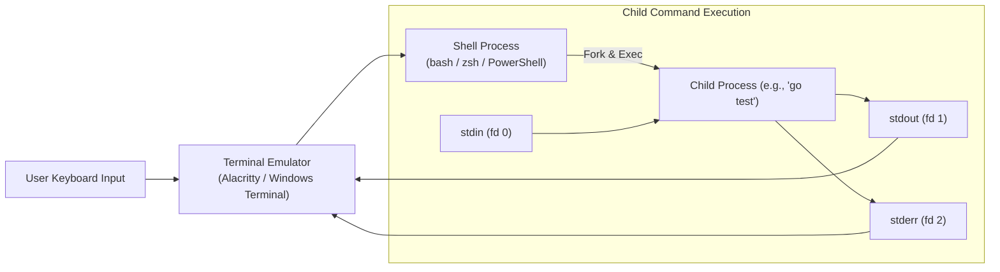

# Terminal basics

## Learning objective

Navigate the shell, execute commands, manipulate file streams via redirection and piping, and inspect process exit statuses in the terminal.

## Why this matters

New developers face the terminal with anxiety because every error looks like random noise. Understanding what the shell does — parsing, resolving, forking, waiting — transforms the terminal from a scary black box into a predictable tool.

## Mental model

The terminal emulator is an interactive text interface connected to a command-line interpreter (the shell, e.g., Bash, Zsh, PowerShell). The shell operates in an infinite REPL loop:
1. **Read:** Accepts a line of typed input from the user.
2. **Parse & Resolve:** Tokenizes the command string, expands environment variables and wildcards, and searches the paths listed in `$PATH` for a matching executable.
3. **Spawn & Connect:** Spawns a child process and attaches the three standard I/O streams: standard input (`stdin`, fd 0), standard output (`stdout`, fd 1), and standard error (`stderr`, fd 2).
4. **Wait:** Pauses until execution finishes, collecting the child process's integer exit code.

## Visual model



## Core idea

The terminal predates GUIs and remains the most powerful interface for software development because it is composable, scriptable, remote-friendly, and consistent across machines. Learning the terminal is learning to speak the computer's native language.

## Under the hood

Every terminal command creates at minimum one OS process. The shell uses fork+exec on Unix or CreateProcess on Windows. stdin/stdout/stderr are file descriptors inherited from the parent shell. The shell's job is to orchestrate these processes — piping fd 1 of process A to fd 0 of process B, collecting exit codes, and managing job control (foreground/background).

## How Go uses it

Go developers use the terminal constantly: `go run` to test code, `go test` to verify correctness, `go build` to produce binaries, `go mod tidy` to manage dependencies, and `go vet` to catch bugs. The `go` command is itself a terminal program with flags, arguments, and exit codes.

## Go example

The example implements a minimal shell simulator. It reads input from stdin via `bufio.Scanner`, tokenizes the input by splitting on whitespace, and dispatches commands. It supports `echo` (prints arguments), `hello` (prints a greeting), and `exit` (terminates the process). Unknown commands produce a "command not found" error — mirroring how real shells resolve commands via PATH lookup.

```go
package main

import (
	"bufio"
	"fmt"
	"os"
	"strings"
)

func main() {
	fmt.Println("=== Minimal Go Shell Simulator ===")
	fmt.Println("Commands: echo <args>, hello, exit")

	scanner := bufio.NewScanner(os.Stdin)
	for {
		fmt.Print("gosh> ")
		if !scanner.Scan() {
			break // EOF
		}

		line := strings.TrimSpace(scanner.Text())
		if line == "" {
			continue
		}

		tokens := strings.Fields(line)
		cmd := tokens[0]
		args := tokens[1:]

		switch cmd {
		case "exit":
			fmt.Println("Session terminated. Exit code 0.")
			return
		case "hello":
			fmt.Println("Hello from the Go shell simulator!")
		case "echo":
			fmt.Println(strings.Join(args, " "))
		default:
			fmt.Fprintf(os.Stderr, "gosh: command not found: %s\n", cmd)
		}
	}
}
```

## Step-by-step execution

1. The user opens a terminal emulator which starts a shell process (bash, zsh, or PowerShell).
2. The shell prints a prompt and waits for input — the user types a command and presses Enter.
3. The shell parses the input, resolves the command (built-in, alias, or PATH lookup), forks a child process, and waits for it to complete.
4. In the [Shell + Git Lab](../projects/shell-git-lab/README.md): the verify script runs shell commands directly and checks their output. There is no Go simulation — you practice using a real terminal.
5. The child process runs, reading from stdin and writing to stdout/stderr until it exits.
6. The shell collects the exit code, displays the next prompt, and waits for the next command.

## Common mistakes

| Mistake | Why it happens | Fix |
|---|---|---|
| Typing commands without understanding the working directory | Running `rm -rf *` in the wrong directory can be catastrophic | Always check `pwd` before running destructive commands |
| Confusing the terminal with the shell | The terminal is the window; the shell is the program running inside it | The terminal emulator hosts the shell; closing the terminal kills the shell |
| Using relative paths without checking the current directory | Leads to "file not found" errors | Use `pwd` to confirm the working directory or use absolute paths |

## Debugging walkthrough

**Scenario: A beginner runs a command that modifies files but gets "permission denied".**
- **Cause:** The user does not have write permission on the target directory or file.
- **Diagnosis:** Run `ls -la` on the target to see ownership and permission bits.
- **Resolution:** Use `sudo` (on Unix) or run as Administrator (on Windows), or change permissions with `chmod`.

**Scenario: A learner runs a command with spaces in a file path and gets unexpected behavior.**
- **Cause:** The shell splits arguments on spaces; the path is broken into multiple arguments.
- **Diagnosis:** Count the arguments the command actually receives (use `echo $#` in bash).
- **Resolution:** Quote the path: `"My Documents/file.txt"` or escape spaces: `My\ Documents/file.txt`.

## Production notes

Professional developers spend hours daily in the terminal running builds, tailing logs, grepping code, managing git, deploying services, and debugging production. Terminal fluency is the difference between fighting the machine and commanding it.

## Performance implications

- Starting a new shell process for every command adds ~1-5ms overhead — negligible for interactive use but significant in tight loops.
- Piping large datasets between commands avoids writing temp files to disk, reducing I/O by 10-100x.
- Using shell built-ins (`cd`, `echo`, `source`) is faster than external commands since no process fork is needed.

## Tests / verification

1. Open your terminal. Run `echo "hello"` and confirm output goes to stdout. Run `echo "error" >&2` (bash) or `Write-Error "error"` (PowerShell) to confirm stderr output.
2. Chain commands with `&&` (run next only if previous succeeds) and `||` (run next only if previous fails). For example: `true && echo "yes"` vs `false && echo "no"`.
3. Redirect output with `>` to a file, then append with `>>`. Pipe data between two commands with `|`. Explain which process owns each step.

## Review questions

1. Navigate to a specific directory using only `cd` and `ls`, then confirm the absolute path with `pwd`.
2. Predict whether a given command is a shell built-in or an external program.
3. What happens when Ctrl+C is pressed while a command is running?
4. How does the shell find the program to run when you type a command name?
5. What is the difference between stdout and stderr?

## NEXT UP

[Lesson 05: Environment variables](../05-environment-variables/README.md)
