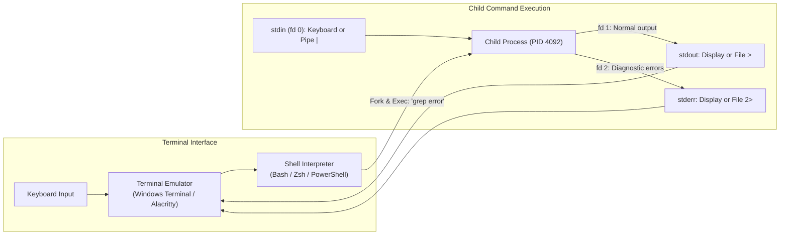

# Terminal basics

## Learning objective

Navigate the shell, execute commands, manipulate file streams via redirection and piping, and inspect process exit statuses in the terminal.

## Why this matters

New developers often face the terminal with anxiety because every error looks like opaque wall text. But the terminal is not an antique relic — it is the primary control deck for every software engineer, cloud infrastructure engineer, and DevOps specialist. Understanding what the shell does behind the scenes — parsing arguments, resolving `$PATH`, forking child processes, wiring standard streams, and harvesting exit codes — transforms the terminal from an intimidating black box into a predictable, high-precision power tool.

## Mental model

The terminal system consists of two separate programs cooperating:
1. **The Terminal Emulator:** The graphical window (Windows Terminal, iTerm2, Alacritty, GNOME Terminal) that captures keyboard strokes and renders visual character glyphs onto the screen.
2. **The Shell Interpreter:** The interactive command language program (Bash, Zsh, PowerShell) running inside the emulator. The shell operates in an infinite loop known as the **REPL (Read-Eval-Print Loop)**:
   - **Read:** Waits for user keystrokes until the Enter key (`\n`) is pressed.
   - **Parse & Expand:** Tokenizes the command string into an executable name and arguments array (`argv`), expands environment variables (`$HOME`), and resolves wildcards (`*.go`).
   - **Resolve:** Searches shell built-ins (`cd`, `exit`), aliases, and the directories listed in the `$PATH` environment variable for a matching executable.
   - **Fork & Connect:** Requests the OS kernel to spawn a child process, attaching three standard I/O streams: Standard Input (`stdin`, fd 0), Standard Output (`stdout`, fd 1), and Standard Error (`stderr`, fd 2).
   - **Wait:** Pauses the shell until the child process completes execution, then captures its numerical exit code.

## Visual model



## Core idea

GUIs present rigid, pre-defined buttons; the command-line interface (CLI) provides a composable programming language where small, focused tools connect together like plumbing pipes. Master the terminal, and you can automate any multi-step development, testing, build, or deployment task effortlessly.

## The Shell Command Rosetta Stone

Whether developing on Linux, macOS, or Windows, you will frequently transition between POSIX shells (Bash, Zsh, Git Bash) and Windows PowerShell. Below is the definitive cross-platform command reference:

| Purpose | POSIX (Bash / Zsh / Git Bash) | Windows PowerShell | Meaning & Usage |
|---|---|---|---|
| **Current Directory** | `pwd` | `pwd` or `Get-Location` | Print the current working directory path |
| **Change Directory** | `cd <dir>` | `cd <dir>` or `Set-Location` | Navigate into target directory |
| **Parent Directory** | `cd ..` | `cd ..` | Move one directory up the tree |
| **Home Directory** | `cd ~` or `cd` | `cd ~` | Jump directly to user's home folder |
| **Previous Directory** | `cd -` | `cd -` | Jump back to the last visited folder |
| **List Contents** | `ls` | `ls` or `Get-ChildItem` | List visible files in directory |
| **List Details & Hidden**| `ls -la` | `Get-ChildItem -Force` | Show permissions, size, dates, and hidden files (`.git`) |
| **Make Directory** | `mkdir -p a/b/c` | `mkdir a/b/c` or `New-Item -ItemType Directory` | Create directory tree including parents |
| **Create Empty File** | `touch file.txt` | `New-Item file.txt` | Create empty file or update timestamp |
| **Copy File / Tree** | `cp -r src/ dst/` | `Copy-Item -Recurse src/ dst/` | Recursively copy files and folders |
| **Move / Rename** | `mv old.txt new.txt` | `Move-Item old.txt new.txt` | Move or rename a file or directory |
| **Delete File / Tree**| `rm -rf dir/` | `Remove-Item -Recurse -Force dir/`| Recursively delete without confirmation |
| **Print File Content** | `cat file.txt` | `cat file.txt` or `Get-Content` | Output entire file content to stdout |
| **View First N Lines** | `head -n 20 file.txt` | `Get-Content file.txt -Head 20` | Output top 20 lines of a file |
| **View Last N Lines** | `tail -n 20 file.txt` | `Get-Content file.txt -Tail 20` | Output bottom 20 lines of a file |
| **Follow Live File** | `tail -f app.log` | `Get-Content app.log -Wait` | Stream new lines as they are written |
| **Search Pattern** | `grep "error" app.log` | `Select-String "error" app.log` | Filter lines matching regex or string |

## Streams, Redirection, and Piping Masterclass

Every process is born with three standard communication channels:
- **`stdin` (File Descriptor 0):** Input stream read by the program (default: keyboard).
- **`stdout` (File Descriptor 1):** Standard output written by the program for normal results (default: screen).
- **`stderr` (File Descriptor 2):** Diagnostic error stream written for warnings, stack traces, and errors (default: screen).

Because `stdout` and `stderr` both print to the screen by default, beginners assume they are the same. In reality, the shell can redirect each stream independently:

### 1. File Redirection Operators
- `command > file.txt`: Redirects `stdout` to `file.txt`, **overwriting** existing content.
- `command >> file.txt`: Redirects `stdout` to `file.txt`, **appending** to the bottom of the file.
- `command 2> error.log`: Redirects `stderr` (fd 2) to `error.log`, leaving normal `stdout` on screen.
- `command > output.log 2>&1`: Merges `stderr` into `stdout`, sending all output into `output.log`.
- `command < input.txt`: Feeds the contents of `input.txt` into the program's `stdin`.

### 2. The Pipe Operator (`|`)
The pipe operator connects the `stdout` (fd 1) of the left-hand command directly into the `stdin` (fd 0) of the right-hand command in system memory without creating intermediate temporary files on disk:
```bash
# Filter active processes for 'go', count the lines:
ps aux | grep "go" | wc -l
```

### 3. Command Chaining Operators
- `cmd1 && cmd2`: **Logical AND** — Runs `cmd2` only if `cmd1` exited with code `0` (success).
- `cmd1 || cmd2`: **Logical OR** — Runs `cmd2` only if `cmd1` exited with a non-zero code (failure).
- `cmd1 ; cmd2`: **Sequential** — Runs `cmd1`, then runs `cmd2` regardless of outcome.

### 4. Execution Permissions & Shebangs
On POSIX systems (Linux, macOS, Git Bash), scripts must have execute permissions to run directly:
```bash
chmod +x build.sh
./build.sh
```
The first line of an executable script must contain a **shebang** (`#!`), which tells the kernel which interpreter to invoke:
```bash
#!/usr/bin/env bash
```

## How Go uses it

Go developers live in the terminal:
- `go run main.go`: Compiles in memory and runs the binary.
- `go test -v ./...`: Runs all test suites with verbose terminal logging.
- `go build -o server .`: Produces a standalone binary for deployment.
- `go vet ./...`: Analyzes code for suspicious constructs.
The `os/exec` standard library package allows Go programs to spawn external shell processes and wire custom `stdin`, `stdout`, and `stderr` pipes directly in Go code.

## Go example

The example program demonstrates spawning a real child process, redirecting input through a stdin pipe, capturing stdout and stderr separately, and inspecting the child process exit code:

```go
package main

import (
	"bytes"
	"fmt"
	"os/exec"
	"runtime"
	"strings"
)

func main() {
	fmt.Println("=== Terminal Subprocess & Stream Redirection Demo ===")

	var cmd *exec.Cmd
	var inputData string

	if runtime.GOOS == "windows" {
		// Use PowerShell on Windows
		inputData = "apple\nbanana\ncherry\nblueberry\napple pie\n"
		cmd = exec.Command("powershell", "-NoProfile", "-Command", "$input | Select-String 'apple'")
	} else {
		// Use standard POSIX grep on Linux/macOS
		inputData = "apple\nbanana\ncherry\nblueberry\napple pie\n"
		cmd = exec.Command("grep", "apple")
	}

	// 1. Wire stdin pipe with simulated input data
	cmd.Stdin = strings.NewReader(inputData)

	// 2. Attach separate memory buffers for stdout (fd 1) and stderr (fd 2)
	var stdoutBuf, stderrBuf bytes.Buffer
	cmd.Stdout = &stdoutBuf
	cmd.Stderr = &stderrBuf

	fmt.Println("Feeding stdin to child process:")
	fmt.Print(inputData)

	// 3. Execute process and wait for termination
	err := cmd.Run()

	fmt.Println("\n=== Process Output Results ===")
	fmt.Printf("Captured stdout (fd 1):\n%s", stdoutBuf.String())

	if stderrBuf.Len() > 0 {
		fmt.Printf("Captured stderr (fd 2):\n%s\n", stderrBuf.String())
	} else {
		fmt.Println("Captured stderr (fd 2): (clean, 0 error bytes)")
	}

	// 4. Inspect exit code
	if err != nil {
		if exitErr, ok := err.(*exec.ExitError); ok {
			fmt.Printf("Process exited with non-zero code: %d\n", exitErr.ExitCode())
		} else {
			fmt.Printf("Execution failed: %v\n", err)
		}
	} else {
		fmt.Println("Process exited successfully with Exit Code 0.")
	}
}
```

## Step-by-step execution

1. The user opens their terminal emulator (e.g., Windows Terminal), which starts an interactive shell session.
2. The user types `mkdir -p project/src && cd project/src` and presses Enter.
3. The shell tokenizes the string, recognizes `&&`, and evaluates the left command first: it spawns a child process for `mkdir` with arguments `["-p", "project/src"]`.
4. The OS kernel executes `mkdir`, creates the directories, and exits with code `0`.
5. The shell sees exit code `0`, satisfies the `&&` condition, and executes the built-in command `cd project/src`, updating the shell process's internal working directory.
6. The shell renders the new prompt with the updated path, waiting for the user's next command.

## Common mistakes

| Mistake | Why it happens | Fix |
|---|---|---|
| Forgetting spaces around operators | Typing `echo hello>file.txt` or `cmd1&&cmd2` | While some shells accept this, always include clear whitespace around redirection and pipe operators |
| Using single `>` when appending was intended | Using `>` overwrites the destination file completely | Use `>>` whenever you want to append log entries without destroying existing data |
| Forgetting execution permissions on Unix | Attempting `./script.sh` and seeing `Permission denied` | Run `chmod +x script.sh` to set the executable bit (`0755`) |
| Typing commands with unquoted spaces | Running `rm My Documents/report.pdf` deletes two separate files | Quote paths containing spaces: `rm "My Documents/report.pdf"` |

## Debugging walkthrough

**Scenario: A developer runs `go test ./... > test.log` to save test output, but when a test fails, error messages still print to the screen and `test.log` is missing the failures.**
- **Cause:** Go test prints compilation errors and panic stack traces to `stderr` (fd 2). Single `>` only redirects `stdout` (fd 1); `stderr` remained connected to the terminal screen.
- **Diagnosis:** Run `go test ./... 2> error.log` and notice all failure details captured in `error.log`.
- **Resolution:** Redirect both streams into the same file using `go test ./... > test.log 2>&1`.

**Scenario: A developer runs a script with `./verify.sh` and gets `verify.sh: line 1: /bin/bash^M: bad interpreter`.**
- **Cause:** The script was saved with Windows CRLF (`\r\n`) line endings. The Linux kernel reads `\r` as part of the binary name.
- **Diagnosis:** Run `head -n 1 verify.sh | cat -v`. It will display `#!/bin/bash^M`.
- **Resolution:** Convert line endings with `dos2unix verify.sh` or configure your editor to save with LF.

## Production notes

CI/CD automation pipelines (GitHub Actions, GitLab CI) are fundamentally shell scripts executed by a runner process. Every step in a YAML workflow file runs inside a shell (`bash -e {0}`). If a command in your CI step exits with a non-zero code, the shell terminates immediately, failing the build. Mastery of shell streams and exit codes is essential for diagnosing why a CI pipeline broke in production.

## Performance implications

- Spawning a child process requires the OS to allocate a PCB, virtual memory tables, and duplicate file descriptors (~1–5ms overhead).
- In-memory piping (`cmd1 | cmd2`) is memory-buffered by the kernel (typically a 64 KB pipe buffer); data streams between processes without touching physical SSD storage.
- Using shell built-ins (`cd`, `echo`) executes inside the existing shell process with zero process creation overhead.

## Tests / verification

1. Test file and directory navigation:
   - Create a directory: `mkdir -p test_shell/docs`
   - Enter it: `cd test_shell/docs`
   - Verify location: `pwd` (POSIX) or `Get-Location` (PowerShell)
2. Test file creation and redirection:
   - Overwrite: `echo "first line" > output.txt`
   - Append: `echo "second line" >> output.txt`
   - Inspect: `cat output.txt` (verify both lines appear)
3. Test pipeline filtering:
   - POSIX: `cat output.txt | grep "second"`
   - PowerShell: `Get-Content output.txt | Select-String "second"`
4. Test conditional chaining:
   - Run `echo "success" && echo "second command ran"`
   - Notice how both commands run because the first succeeded.

In the [Shell + Git Lab](../projects/shell-git-lab/README.md), you will apply all these commands in a verified project that tests directory trees, stream redirection, and Git integration.

## Review questions

1. What is the technical difference between a terminal emulator and a shell interpreter?
2. What are the three standard I/O streams and their corresponding file descriptor numbers?
3. What is the difference between `>` and `>>` in shell redirection?
4. How does the pipe operator (`|`) transfer data between two processes without creating a temporary file on disk?
5. What does the `&&` operator do when chaining two shell commands, and under what condition will the second command be skipped?

## NEXT UP

[Lesson 05: Environment variables](../05-environment-variables/README.md)
