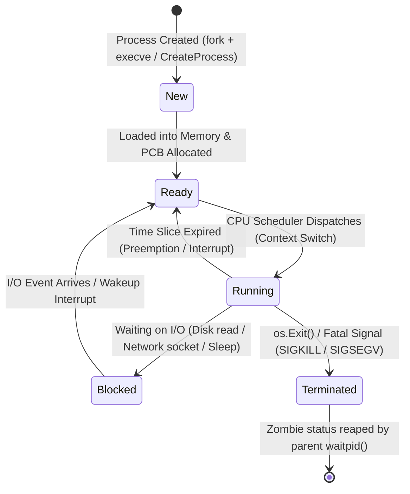

# How the OS manages processes

## Learning objective

Analyze operating system process scheduling, virtual memory isolation, PID tracking, and process states (running, waiting, terminated).

## Why this matters

Modern servers run hundreds of concurrent programs on a single machine without interference. A web server, database, background cron job, and monitoring agent all share the same physical CPU, RAM, and network interface cards. Understanding how the operating system kernel manages processes — through scheduling, memory isolation, process trees, and signal handling — is essential for debugging production concurrency issues, memory leaks, zombie processes, and microservice deadlocks.

## Mental model

A **Process** is an active, executing instance of a computer program. The operating system kernel enforces strict boundaries between processes:
- **Private Address Space:** Process A cannot read or write memory belonging to Process B. An attempt to do so triggers a hardware MMU fault (`SIGSEGV`).
- **The Process Hierarchy:** Every process (except the root kernel process) is spawned by a parent. This creates a single, global **Process Tree**:
  - Linux root: PID 1 (`systemd` or `init`)
  - macOS root: PID 1 (`launchd`)
  - Windows root: System (`smss.exe` / `services.exe`)
- **Process States:** The kernel scheduler continuously cycles processes through standard states: **New**, **Ready**, **Running**, **Blocked (Waiting on I/O)**, and **Terminated (Zombie)**.

## Visual model



## Core idea

Without OS-managed processes, every programmer would have to write their own cooperative scheduler and manage raw physical memory offsets — an unstable nightmare where a single buggy loop would crash the entire machine. Operating system processes provide hardware-enforced preemption, memory isolation, and fair resource distribution.

## Under the hood

### 1. The Process Control Block (PCB)
In the Linux kernel, every process is represented by a massive C struct called `task_struct`. On Windows, it is represented by `EPROCESS`. The PCB tracks:
- **Identifier:** Process ID (`PID`) and Parent Process ID (`PPID`).
- **Memory Map (`mm_struct`):** Pointers to the page tables that translate virtual memory addresses into physical RAM chips.
- **File Descriptor Table (`files_struct`):** Pointers to all opened files, pipes, and network sockets (indices 0, 1, 2, ...).
- **Execution Context:** Saved CPU hardware registers (`RIP`, `RSP`, `RAX`, flags) when the process is not currently running on a physical core.
- **Signal Handlers:** Actions to take when asynchronous kernel signals arrive.

### 2. Context Switching
A CPU core can execute instructions for only one process at a time. The OS scheduler enforces **Preemptive Multitasking**:
1. A hardware timer interrupt fires (typically every 1–10 milliseconds).
2. The CPU pauses user-space execution and switches to kernel mode.
3. The kernel saves the current process's hardware registers into its PCB.
4. The scheduler picks the next "Ready" process from the run queue (using CFS — Completely Fair Scheduler on Linux).
5. The kernel switches virtual memory page tables to point to the new process's address space.
6. The saved registers of the new process are restored into the CPU, and the Instruction Pointer (`RIP`) resumes where it left off.
This entire operation takes ~1–2 microseconds.

### 3. Signals (Inter-Process Communication)
Signals are asynchronous notifications sent by the kernel or other processes:
- `SIGINT` (Signal 2): Keyboard interrupt (`Ctrl+C`). Can be caught and handled for graceful shutdown.
- `SIGTERM` (Signal 15): Polite termination request sent by Kubernetes or `kill <pid>`. Applications catch this to finish in-flight HTTP requests and close database pools before exiting.
- `SIGKILL` (Signal 9): Violent, immediate termination (`kill -9 <pid>`). The kernel immediately destroys the process PCB; it **cannot** be caught, blocked, or ignored by application code.

### 4. Zombies vs Orphans
- **Zombie Process (`<defunct>`):** A process that has called `exit()`, freed its memory and file descriptors, but its PCB remains in the kernel process table because its parent has not yet collected its exit code via `waitpid()`. A few zombies are harmless, but thousands exhaust the system's PID table.
- **Orphan Process:** A process whose parent died while the child was still running. The OS kernel immediately **re-parents** the orphan to PID 1 (`systemd`/`init`), which periodically reaps terminated children.

## How Go uses it

- The Go runtime abstracts OS processes and threads: Go multiplexes thousands of lightweight **goroutines** onto a pool of OS threads managed by the **M:N Go scheduler** (`GOMAXPROCS`).
- To inspect process metadata, Go provides `os.Getpid()` and `os.Getppid()`.
- To spawn child processes, Go provides the `os/exec` package (`exec.Command`).
- To handle graceful termination signals, Go provides the `os/signal` package (`signal.Notify`).

## Go example

The example program demonstrates querying the process's own PID and PPID, inspecting active system processes, and spawning a managed child process while observing its exit status:

```go
package main

import (
	"fmt"
	"os"
	"os/exec"
	"runtime"
)

// ProcessMetadata encapsulates basic identity of an active process.
type ProcessMetadata struct {
	PID  int
	PPID int
	OS   string
	Arch string
}

func main() {
	meta := ProcessMetadata{
		PID:  os.Getpid(),
		PPID: os.Getppid(),
		OS:   runtime.GOOS,
		Arch: runtime.GOARCH,
	}

	fmt.Println("=== Active Process Metadata ===")
	fmt.Printf("Process ID (PID):         %d\n", meta.PID)
	fmt.Printf("Parent Process ID (PPID): %d (Your Terminal Shell)\n", meta.PPID)
	fmt.Printf("Operating System / Arch:  %s / %s\n", meta.OS, meta.Arch)

	fmt.Println("\n=== Spawning and Managing a Child Process ===")
	var childCmd *exec.Cmd

	if runtime.GOOS == "windows" {
		childCmd = exec.Command("cmd.exe", "/c", "echo Hello from Child Process && exit 0")
	} else {
		childCmd = exec.Command("sh", "-c", "echo 'Hello from Child Process' && exit 0")
	}

	// Capture output
	output, err := childCmd.CombinedOutput()
	if err != nil {
		fmt.Printf("Child process failed: %v\n", err)
		return
	}

	fmt.Printf("Child Output: %s", string(output))
	if childCmd.ProcessState != nil {
		fmt.Printf("Child Exit Code: %d (Success: %t)\n",
			childCmd.ProcessState.ExitCode(),
			childCmd.ProcessState.Success(),
		)
	}

	fmt.Println("\nProcess lifecycle demonstrated: Parent spawned Child -> Child executed -> Parent reaped exit code.")
}
```

## Step-by-step execution

1. The user launches an application from their shell (e.g., PID 1200).
2. The shell calls `fork()` to create a duplicate child process, which the kernel assigns a new PID (e.g., PID 5430, with PPID 1200).
3. The child calls `execve()`, which replaces its memory space with the application binary and resets registers.
4. The kernel places PID 5430 in the **Ready** run queue.
5. The scheduler performs a **context switch**, loading PID 5430 onto a CPU core in the **Running** state.
6. When the process performs I/O (reads a file or waits on network), it transitions to **Blocked**, relinquishing the CPU core.
7. Upon completing work, the process calls `exit(0)`.
8. The kernel frees its memory pages, closes open file descriptors, sets its state to **Terminated (Zombie)**, and sends `SIGCHLD` to PID 1200.
9. The shell collects the exit code using `waitpid()`, and the kernel permanently purges PID 5430 from the process table.

## Common mistakes

| Mistake | Why it happens | Fix |
|---|---|---|
| Confusing processes with threads | Both execute code concurrently | Understand that processes have private isolated memory; threads within a process share the same memory space |
| Attempting to catch `SIGKILL` | Wanting to run cleanup code on force-kill | `SIGKILL` (9) is handled directly by the kernel and cannot be intercepted; use `SIGTERM` (15) for graceful shutdowns |
| Leaking zombie processes in custom supervisors | Parent spawns child processes but forgets to call `wait()` | Always call `cmd.Wait()` or use a signal loop to reap child processes |
| Assuming high PID means high CPU usage | PIDs are simply sequential integers assigned at process creation | Use `top`, `htop`, or Task Manager to measure CPU and memory utilization |

## Debugging walkthrough

**Scenario: A microservice stops responding to HTTP requests, but its PID is still visible in `ps aux`, marked as `<defunct>`.**
- **Cause:** The process terminated, but its parent process hung or failed to call `waitpid()`, leaving the child as a zombie.
- **Diagnosis:** Run `ps aux | grep Z` or `ps -el | grep defunct`. The `Z` state confirms a zombie process.
- **Resolution:** A zombie is already dead and cannot be killed with `kill -9`. You must kill or restart the *parent process*; the orphaned zombie will then be re-parented to PID 1, which will immediately reap it.

**Scenario: A Go service deployed in a Docker container takes exactly 10 seconds to stop when you run `docker stop`.**
- **Cause:** Docker sends `SIGTERM` and waits 10 seconds. If the application does not exit, Docker sends `SIGKILL`. If your Go application does not listen for `SIGTERM` using `signal.Notify`, it ignores `SIGTERM` and gets forcibly killed after 10 seconds.
- **Diagnosis:** Inspect application logs during shutdown. If no shutdown logs appear before termination, `SIGTERM` was unhandled.
- **Resolution:** Use `signal.Notify(ch, syscall.SIGTERM, syscall.SIGINT)` in Go and gracefully drain HTTP connections.

## Production notes

In containerized microservice architectures (Kubernetes, Docker), understanding PID 1 is critical. If your application container does not run a proper init process, background zombie processes spawned by child commands will not be reaped, eventually exhausting the container's PID limit (`pids.max`). Modern container configurations often use tools like `tini` as PID 1 to ensure proper zombie reaping and signal forwarding.

## Performance implications

- Creating an OS process via `fork + exec` is relatively heavy (~1–5 ms) because the kernel must allocate page tables and PCB structures.
- Go goroutines, by contrast, are user-space constructs: creating a goroutine takes ~0.2 microseconds and only 2 KB of initial stack memory.
- Context switches between OS processes cause CPU cache pollution (L1/L2 caches lose locality), whereas goroutine switches avoid page-table switches.

## Tests / verification

1. Inspect the process tree on your operating system:
   - Linux / macOS: Run `pstree -p` or `ps -ef` to see parent-child PID relationships.
   - Windows PowerShell: Run `Get-Process | Select-Object -First 10 Id, ProcessName, CPU`
2. Test signal handling in your terminal:
   - Start a long-running command: `sleep 100` (POSIX) or `Start-Sleep 100` (PowerShell).
   - Press `Ctrl+C` to send `SIGINT` and verify the process terminates immediately.
3. Observe process PID and PPID using the example Go program:
   - Run `go run ./curriculum/modules/01-computers-terminal-git-web/07-how-the-os-manages-processes`.
   - Confirm that PPID matches the process ID of your terminal shell.

## Review questions

1. What is the fundamental difference between an operating system process and an operating system thread?
2. What are the five standard lifecycle states of a process, and what triggers the transition from "Running" to "Blocked"?
3. What is the difference between a zombie process and an orphan process?
4. Why can `SIGKILL` (signal 9) not be caught or handled by application code, unlike `SIGTERM` (signal 15)?
5. Why are Go goroutines significantly cheaper to create and switch between than full OS processes?

## NEXT UP

[Lesson 08: Memory preview: stack vs heap](../08-memory-preview-stack-vs-heap/README.md)
