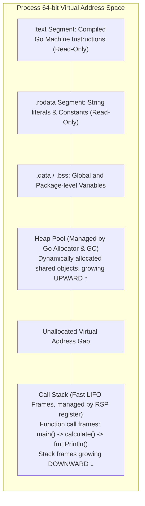

# Memory preview: stack vs heap

## Learning objective

Compare memory layout structures, distinguishing the fast automatic lifecycle of the call stack from the heap allocator.

## Why this matters

In software engineering, not all data lives for the same duration. Some data exists only for the millisecond a function takes to calculate a sum, while other data (like user sessions or database connection pools) must persist across thousands of function calls. Understanding where variables live physically in memory — the lightning-fast, automatic **Call Stack** versus the flexible, managed **Heap** — is the single most important mental model for understanding memory leaks, garbage collection latency, and high-performance backend design.

> [!NOTE]
> **Zero-Magic Reassurance for Beginners:**
> Do not worry if you have not learned Go pointer syntax (`*int`, `&x`) or dynamic slices (`make`) yet! Go syntax will be formally taught step-by-step starting in Module 02, and pointer mechanics in Module 04. This lesson is a **conceptual and physical architecture preview**: it introduces *why* memory is physically partitioned into stack and heap before you begin writing syntax.

## Mental model

Imagine process memory as two distinct workspaces:
- **The Call Stack (The Stack of Trays):** A strictly organized, Last-In-First-Out (LIFO) scratchpad for function-local variables. When a function is called, a new frame is pushed onto the stack. When the function returns, its frame is immediately popped off. Allocation and cleanup are completely automatic and cost almost zero CPU cycles.
- **The Dynamic Heap (The Shared Storage Warehouse):** A large, flexible pool of memory for variables that must survive beyond the function that created them, or whose size cannot be known at compile time. Data stays on the heap until explicitly freed or reclaimed by Go's Garbage Collector (GC).

## Visual model



## Core idea

Memory is physical silicon; when a process requests RAM from the operating system, it receives a flat array of virtual address numbers. The programming language runtime splits this space into structured regions: the stack gives functions blisteringly fast, temporary scratch space, while the heap gives functions shared, long-lived storage.

## Under the hood

### 1. The Call Stack & Hardware Pointer Bumping
The call stack is controlled physically by the CPU's **Stack Pointer (`RSP`)** hardware register.
- **Allocating Memory on Stack:** When a function calls another function with local variables, the compiler subtracts the required number of bytes from `RSP` (e.g., `SUBQ $0x20, %rsp`). Allocating 32 bytes of local variables is a single CPU instruction taking **~0.3 nanoseconds**.
- **Freeing Memory on Stack:** When the function returns, the compiler adds those bytes back to `RSP` (`ADDQ $0x20, %rsp`). Deallocation takes zero overhead, causes zero memory fragmentation, and requires zero garbage collector intervention.
- In Go, each goroutine starts with its own tiny, dynamic stack (initially only **2 KB**), which grows and shrinks automatically in memory as needed.

### 2. The Dynamic Heap & Garbage Collection
The heap is an arbitrary memory arena:
- Allocating memory on the heap requires invoking Go's memory allocator (`mallocgc`), which searches free-list buckets (arenas, spans, and size classes) to find a chunk of memory that fits the requested size.
- Because heap objects can be referenced by any function or thread at any time, they cannot be cleaned up when a function returns.
- Go runs an automatic, concurrent **Garbage Collector (GC)** that periodically pauses or scans application memory, traces which heap objects are still reachable, and sweeps away unreferenced memory to prevent memory leaks.

### 3. Escape Analysis: How the Compiler Decides
You do not explicitly tell Go whether to put a variable on the stack or the heap. The Go compiler performs **Escape Analysis** during compilation:
- If the compiler can prove that a variable's address is never accessed after its enclosing function returns, it allocates the variable on the **stack**.
- If a pointer to a local variable is returned, stored in a global variable, or passed into an interface, the variable **"escapes to the heap"**.

## How Go uses it

In languages like C, developers must manually call `malloc()` and `free()`, where forgetting `free()` causes memory leaks and freeing too early causes catastrophic security vulnerabilities (use-after-free). In Go, the compiler and garbage collector collaborate:
- The compiler optimizes performance by keeping everything possible on the fast call stack.
- The runtime safely places escaped objects on the heap and automatically reclaims them with low-latency garbage collection.
- You can inspect the compiler's escape analysis decisions directly using:
  ```bash
  go build -gcflags="-m" .
  ```

## Go example

The example program demonstrates the conceptual difference between a function whose value stays on the stack versus a function returning a reference that escapes to the heap:

```go
package main

import (
	"fmt"
)

// StackValue returns a copy of a local integer.
// The variable 'x' lives strictly inside StackValue's stack frame.
// When StackValue returns, its stack frame is instantly reused.
func StackValue() int {
	x := 42
	return x
}

// HeapValue returns a POINTER (memory address) to a local integer.
// Because the caller needs to access 'x' after HeapValue has returned,
// the Go compiler's escape analysis automatically moves 'x' to the HEAP.
func HeapValue() *int {
	x := 100
	return &x // &x means "the memory address of x"
}

// SliceOnHeap demonstrates dynamic heap allocation.
// The size 'n' is determined at runtime, so the backing array must live on the heap.
func SliceOnHeap(n int) []int {
	numbers := make([]int, n)
	for i := 0; i < n; i++ {
		numbers[i] = (i + 1) * 10
	}
	return numbers
}

func main() {
	fmt.Println("=== Stack vs Heap Memory Preview ===")

	// 1. Stack Allocation
	val := StackValue()
	fmt.Printf("1. StackValue returned integer: %d\n", val)

	// 2. Heap Allocation (Escaped Pointer)
	ptr := HeapValue()
	fmt.Printf("2. HeapValue returned pointer address: %p (Value: %d)\n", ptr, *ptr)

	// 3. Dynamic Heap Slice
	list := SliceOnHeap(3)
	fmt.Printf("3. SliceOnHeap returned %d items: %v\n", len(list), list)

	fmt.Println("\nTakeaway: Local function values live on the fast stack; values that outlive functions move to the heap.")
}
```

## Step-by-step execution

1. The OS kernel executes `main()`, assigning it the initial call stack frame at the top of the stack.
2. `main()` calls `StackValue()`; a new stack frame is pushed, decrementing the CPU Stack Pointer `RSP`.
3. `StackValue()` stores `42` directly in its stack frame memory, copies `42` into register `RAX` for the caller, and returns.
4. The stack frame for `StackValue()` is instantly popped by restoring `RSP`; its memory is abandoned with zero CPU cleanup overhead.
5. `main()` calls `HeapValue()`; because `&x` is returned, the compiler allocated `x` on the dynamic heap via `mallocgc`.
6. `HeapValue()` returns the 64-bit heap address (`%p`), which remains valid even after `HeapValue()` returns.
7. `main()` calls `SliceOnHeap(3)`; dynamic slices allocate their backing array on the heap.
8. When `main()` terminates, the process address space is completely torn down by the OS kernel.

## Common mistakes

| Mistake | Why it happens | Fix |
|---|---|---|
| Assuming pointers always make programs faster | Pointers avoid copying data, but heap allocations trigger garbage collection | For small data (integers, small structs), copying on the stack is much faster than heap allocation |
| Worrying about manual memory management in Go | Experience with C or C++ where memory must be freed manually | Trust Go's escape analysis and GC; focus on writing clear, readable code first |
| Confusing stack overflow with out-of-memory | Both crash the application | Stack overflow is caused by runaway infinite recursion; OOM is caused by filling the heap with unbounded data |

## Debugging walkthrough

**Scenario: A Go program crashes with `runtime: goroutine stack exceeds 1000000000-byte limit; fatal error: stack overflow`.**
- **Cause:** A function called itself recursively without a terminating base condition (`func infinite() { infinite() }`). Each call pushed a new stack frame until the goroutine exceeded the 1 GB stack limit.
- **Diagnosis:** Inspect the crash stack trace. If you see the same function name repeated thousands of times, it is an uncontrolled recursive loop.
- **Resolution:** Add a proper terminating base condition to the recursive function or convert it into an iterative `for` loop.

**Scenario: A high-throughput web server experiences sudden latency spikes every 30 seconds.**
- **Cause:** High allocation rate of short-lived objects escaping to the heap forces Go's Garbage Collector to run frequently, consuming CPU cycles and triggering brief STW (Stop-The-World) mark phases.
- **Diagnosis:** Run `go test -bench . -benchmem` or inspect heap profiles with `go tool pprof`.
- **Resolution:** Reduce heap allocations by reusing memory buffers (`sync.Pool`) or designing structs that stay on the stack.

## Production notes

In modern cloud environments, understanding stack vs. heap allocation is the dividing line between junior and senior backend engineers. Every object allocated on the heap creates work for the Garbage Collector. Go services that achieve sub-millisecond p99 latencies under heavy load do so by minimizing heap allocations — keeping hot data paths running entirely on the call stack.

## Performance implications

- **Stack Allocation:** ~0.3 nanoseconds (a single CPU instruction, zero GC overhead).
- **Heap Allocation:** ~20–50 nanoseconds (allocator search, span locking, metadata tracking).
- **Garbage Collection Sweep:** Costs CPU background cycles proportional to the number of live pointers on the heap.

## Tests / verification

1. Run the example program: `go run ./curriculum/modules/01-computers-terminal-git-web/08-memory-preview-stack-vs-heap`.
2. Inspect the printed output, noticing how the pointer address (`0xc000...`) points to a memory location in the process heap.
3. Verify escape analysis using the Go compiler flag:
   ```bash
   go build -gcflags="-m" ./curriculum/modules/01-computers-terminal-git-web/08-memory-preview-stack-vs-heap
   ```
4. Observe the compiler output lines:
   - Notice lines like: `moved to heap: x` or `make([]int, n) escapes to heap`.
   - This proves the Go compiler made the stack vs. heap decision at compile time!

## Review questions

1. What is the fundamental difference between the Call Stack and the Dynamic Heap?
2. Why is allocating memory on the call stack significantly faster than allocating on the heap?
3. What is "Escape Analysis" in the Go compiler, and what causes a variable to escape to the heap?
4. What happens physically to a function's stack frame when the function finishes and returns?
5. Why does returning a pointer (`&x`) to a local variable require that variable to be allocated on the heap rather than the stack?

## NEXT UP

[Lesson 09: Git mental model](../09-git-mental-model/README.md)
