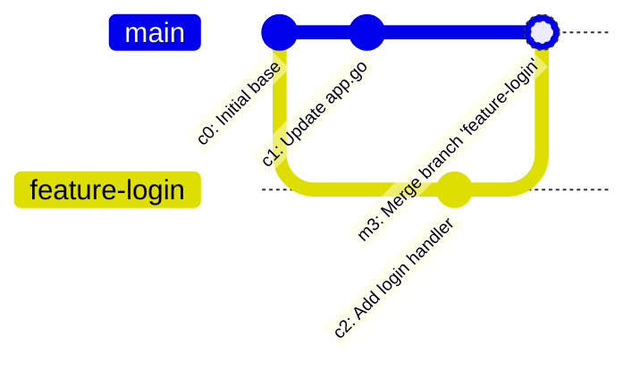

# Branching and merging

## Learning objective

Create, switch, and merge Git branches, resolving merge conflicts and inspecting commit DAG ancestry with git log.

## Why this matters

Teams need to work on multiple features simultaneously without interfering with each other. Branching provides isolation for experimentation, and merging provides a controlled way to integrate completed work.

## Mental model

A branch is just a named pointer to a specific commit. Creating a branch costs nothing — it's just writing 20 bytes (a SHA-1 hash) to a file in `.git/refs/heads/`. The magic is that each branch can move independently as new commits are added, creating divergent histories.

## Visual model



## Core idea

Git branches are lightweight, movable pointers to commits. Merging combines divergent histories by finding the common ancestor (merge base) and applying changes from both branches. The result is a commit graph that records how the codebase evolved.

## Under the hood

Git merge performs a three-way merge using the merge base (B), the current branch tip (A), and the incoming branch tip (C). For each file, Git diffs B→A and B→C, then combines both diffs. If both diffs touch the same line differently, Git marks a conflict with `<<<<<<<`, `=======`, and `>>>>>>>` markers. `git rebase` instead replays C's commits onto A, creating new commit objects with different hashes.

## How Go uses it

Go projects on GitHub use the standard branching model: main is stable, feature branches contain work-in-progress, and pull requests merge branches after review. Go modules use Git tags (v1.2.3) for release versioning.

## Go example

The example program simulates a Git branching model using a struct-based commit graph. It creates a main branch, a feature branch, makes commits on both, and demonstrates a three-way merge with conflict detection.

```go
package main

import (
	"fmt"
)

// Commit represents a node in the Git commit graph.
type Commit struct {
	Hash    string
	Message string
	Parent  *Commit
	Changes map[string]string
}

// Branch is a named pointer to a specific commit.
type Branch struct {
	Name string
	Tip  *Commit
}

func main() {
	fmt.Println("=== Git Branching and 3-Way Merge Simulation ===")

	// 1. Initial base commit on main
	c0 := &Commit{
		Hash:    "a1b2c3d",
		Message: "Initial commit",
		Changes: map[string]string{"README.md": "v1.0", "app.go": "package main"},
	}
	mainBranch := &Branch{Name: "main", Tip: c0}
	fmt.Printf("Initial state: branch %s at commit [%s] %q\n", mainBranch.Name, c0.Hash[:7], c0.Message)

	// 2. Branch off feature branch from c0
	featureBranch := &Branch{Name: "feature-login", Tip: mainBranch.Tip}
	fmt.Printf("Created branch %s at commit [%s]\n", featureBranch.Name, featureBranch.Tip.Hash[:7])

	// 3. Commit on main
	c1 := &Commit{
		Hash:    "f4e5d6c",
		Message: "Update app.go on main",
		Parent:  c0,
		Changes: map[string]string{"README.md": "v1.0", "app.go": "package main // v1.1"},
	}
	mainBranch.Tip = c1

	// 4. Commit on feature branch
	c2 := &Commit{
		Hash:    "9z8y7x6",
		Message: "Add login handler on feature",
		Parent:  c0,
		Changes: map[string]string{"README.md": "v1.0", "login.go": "func Login() {}"},
	}
	featureBranch.Tip = c2

	fmt.Printf("Main advanced to [%s] %q\n", mainBranch.Tip.Hash[:7], mainBranch.Tip.Message)
	fmt.Printf("Feature advanced to [%s] %q\n", featureBranch.Tip.Hash[:7], featureBranch.Tip.Message)

	// 5. 3-Way Merge Simulation
	fmt.Println("\nSimulating merge of feature-login into main...")
	base := c0
	fmt.Printf("Common Ancestor (Merge Base): [%s]\n", base.Hash[:7])

	hasConflict := false
	for file := range mainBranch.Tip.Changes {
		if _, touchedByFeature := featureBranch.Tip.Changes[file]; touchedByFeature && file != "README.md" {
			hasConflict = true
		}
	}

	if !hasConflict {
		mergeCommit := &Commit{
			Hash:    "m3r9e01",
			Message: fmt.Sprintf("Merge branch '%s' into %s", featureBranch.Name, mainBranch.Name),
			Parent:  mainBranch.Tip,
		}
		mainBranch.Tip = mergeCommit
		fmt.Printf("Merge successful! Created merge commit [%s]: %q\n", mergeCommit.Hash[:7], mergeCommit.Message)
	} else {
		fmt.Println("Conflict detected! Manual resolution required.")
	}
}
```

## Step-by-step execution

1. Choose a starting commit (e.g., the latest main) and create a branch: `git branch feature-x` or `git checkout -b feature-x`.
2. Make commits on the branch — the branch pointer advances, main stays at the original commit.
3. When work is complete, switch to main and merge: `git checkout main && git merge feature-x`.
4. Git finds the merge base (common ancestor of main and feature-x) and creates a merge commit combining both histories.
5. If there are conflicts, Git pauses the merge — resolve conflicts in the affected files, `git add` them, and `git merge --continue`.

## Common mistakes

| Mistake | Why it happens | Fix |
|---|---|---|
| Working on main for all changes | Never learned to create branches | Always create a feature branch for any new work |
| Long-lived feature branches diverging from main | Branch was created too early or infrequently merged | Merge or rebase main into the feature branch daily |
| Deleting a branch without merging | Commits on the branch are lost if they were never merged | Check `git branch --merged` before deleting |

## Debugging walkthrough

**Scenario: A merge conflict occurs and the developer resolves it incorrectly.**
- **Cause:** Git cannot automatically merge changes that modify the same lines in different ways.
- **Diagnosis:** Search for `<<<<<<<`, `=======`, and `>>>>>>>` markers in the conflicted files.
- **Resolution:** Use `git mergetool` or manually edit each conflicted section to keep the correct combination, then `git add` the resolved files.

**Scenario: A force-push overwrites teammates' commits.**
- **Cause:** `git push --force` replaces the remote branch pointer without checking for new commits.
- **Diagnosis:** Check `git reflog` on the remote (if accessible) or ask teammates to compare their local history.
- **Resolution:** Use `git push --force-with-lease` instead, which aborts if the remote has unseen commits.

## Production notes

Branching strategies (Git Flow, GitHub Flow, Trunk-Based Development) are foundational to team software development. Every PR, every hotfix, every release candidate uses branches and merges. CI/CD pipelines are triggered by pushes to specific branches.

## Performance implications

- Branch creation is instant and costs negligible disk space — Git stores commits in the shared object database, not per branch.
- Merge conflicts require manual resolution, which can take minutes to hours depending on complexity.
- Rebasing rewrites commit history (new hashes for existing changes), which is fast but forces other developers to re-sync.

## Tests / verification

1. Create a repo, create a `feature` branch, commit two changes. Check out `main` and make a different change. Merge `feature` into `main` — observe either a fast-forward or three-way merge depending on the diverged history.
2. Run `git log --oneline --graph` and note the commit DAG.
3. Create a deliberate merge conflict: edit the same line on two branches, attempt merge, open the conflicted file, identify the conflict markers (`<<<<<<<`, `=======`, `>>>>>>>`), resolve the conflict, add and commit.

The [Shell + Git Lab](../projects/shell-git-lab/README.md) requires you to create branches, switch between them, merge, and resolve a simulated conflict — the same skills this lesson teaches. The verification script enforces that your branch graph and merge history are correct.

## Review questions

1. What is a branch in Git, and how is it stored on disk?
2. What is the difference between a fast-forward merge and a three-way merge?
3. What are the conflict markers and what does each section represent?
4. Why does rebasing change commit hashes?
5. What does `git push --force-with-lease` protect against?

## NEXT UP

[Lesson 12: GitHub workflow](../12-github-workflow/README.md)
