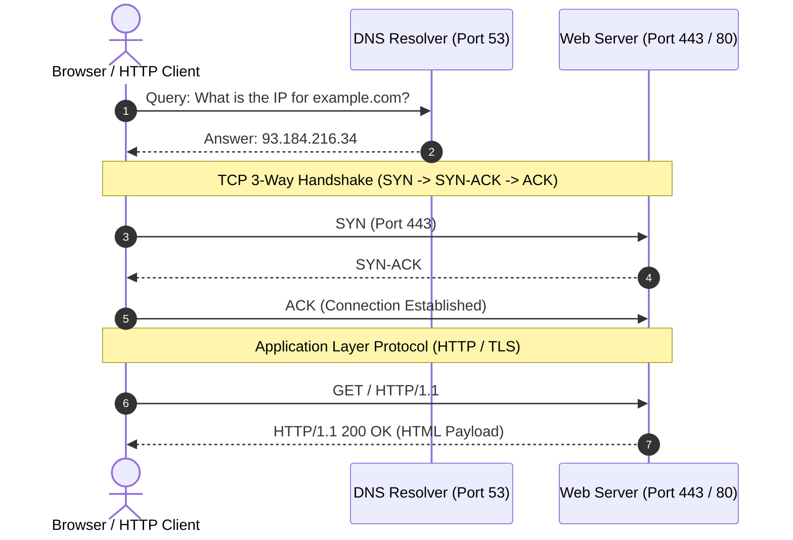

# Web preview: client, server, DNS, and ports

## Learning objective

Trace the client-server architecture of the Web, resolving domain names via DNS and connecting over TCP ports.

## Why this matters

The web would not work without a standard way to locate servers (DNS), connect to them (TCP/IP), and identify which application handles the request (ports). Understanding these layers removes the magic from "how does the browser load a webpage?"

## Mental model

The web is a client-server model: browsers (clients) send requests to servers using the HTTP protocol over TCP connections. DNS translates human-friendly names (google.com) to machine-friendly IP addresses (142.250.80.46). Ports identify which application on the server should handle the request.

## Visual model



## Core idea

The internet relies on four layers working together: DNS resolves domain names to IP addresses, TCP provides reliable connections over IP routing, ports distinguish services on a single machine, and HTTP is the application protocol that clients and servers speak over these connections.

## Under the hood

DNS is a hierarchical distributed database. The root DNS servers delegate to TLD servers (.com, .org), which delegate to authoritative nameservers (e.g., ns1.example.com). The resolver recursively queries these servers until it finds an A (IPv4) or AAAA (IPv6) record. TCP provides reliable, ordered delivery over IP, which is connectionless and best-effort. Ports (16-bit integers, 0-65535) are used by the OS to demultiplex incoming packets to the correct process.

## How Go uses it

Go's `net` package provides DNS resolution (`net.LookupHost`, `net.LookupMX`), TCP/UDP connections (`net.Dial`), and HTTP client/server (`net/http`). Go's standard HTTP server listens on a port with `http.ListenAndServe(":8080", handler)`. The `net/http/httptest` package creates test servers without real ports.

## Go example

The example program resolves a domain name to IP addresses using `net.LookupHost`, establishes a TCP connection using `net.Dial`, and prints connection details including the local and remote addresses and port numbers.

```go
package main

import (
	"fmt"
	"net"
	"time"
)

func main() {
	fmt.Println("=== DNS Resolution and TCP Socket Inspection ===")

	// 1. DNS Resolution
	targetHost := "example.com"
	ips, err := net.LookupHost(targetHost)
	if err != nil {
		fmt.Printf("DNS resolution for %s failed (%v); falling back to 127.0.0.1 for local demo\n", targetHost, err)
		ips = []string{"127.0.0.1"}
	} else {
		fmt.Printf("Resolved DNS host %q to IP addresses:\n", targetHost)
		for _, ip := range ips {
			fmt.Printf("  -> %s\n", ip)
		}
	}

	// 2. Establishing a TCP Listener and Client Connection
	listener, err := net.Listen("tcp", "127.0.0.1:0")
	if err != nil {
		fmt.Printf("failed to bind local listener: %v\n", err)
		return
	}
	defer listener.Close()

	serverAddr := listener.Addr().String()
	fmt.Printf("\nServer listening on: %s\n", serverAddr)

	done := make(chan struct{})
	go func() {
		defer close(done)
		conn, err := listener.Accept()
		if err != nil {
			return
		}
		defer conn.Close()
		fmt.Printf("[Server] Accepted connection from remote: %s\n", conn.RemoteAddr())
	}()

	// 3. Dial TCP Connection
	clientConn, err := net.DialTimeout("tcp", serverAddr, 2*time.Second)
	if err != nil {
		fmt.Printf("Dial failed: %v\n", err)
		return
	}
	defer clientConn.Close()

	fmt.Println("[Client] TCP 3-way handshake established successfully:")
	fmt.Printf("  Local socket:  %s\n", clientConn.LocalAddr())
	fmt.Printf("  Remote socket: %s\n", clientConn.RemoteAddr())

	<-done
}
```

## Step-by-step execution

1. The user types `https://example.com` into a browser and presses Enter.
2. The browser checks its DNS cache, then queries a DNS resolver to resolve `example.com` to an IP address.
3. The browser opens a TCP connection to that IP address on port 443 (HTTPS) — the three-way handshake establishes the connection.
4. The browser performs a TLS handshake to encrypt the connection, then sends an HTTP GET request.
5. The server processes the request, sends an HTTP response with HTML content, and the browser renders the page.

## Common mistakes

| Mistake | Why it happens | Fix |
|---|---|---|
| Hard-coding IP addresses in configuration | Not understanding that IPs change when servers move | Always use DNS hostnames instead of IP addresses |
| Confusing a URL with the underlying IP and port | Not separating the user-friendly name from the machine address | Remember: DNS resolves names to IPs, URLs include the port |
| Thinking every service on a machine uses the same port | Not understanding that ports distinguish services | Each service (HTTP, SSH, database) listens on a different port |

## Debugging walkthrough

**Scenario: An application cannot connect to its database server, even though both are running.**
- **Cause:** The database server listens on localhost (127.0.0.1) but the app connects via the external IP.
- **Diagnosis:** Check the database's `listen_addresses` config and use `netstat -tlnp` to see which interfaces it binds.
- **Resolution:** Configure the database to listen on `0.0.0.0` or the correct network interface, and use the correct hostname from the app.

**Scenario: A web app fails with "connection refused" when connecting to an API.**
- **Cause:** The API server is not running, or it is listening on a different port than the client is connecting to.
- **Diagnosis:** Use `curl -v http://host:port/` or `telnet host port` to test connectivity.
- **Resolution:** Verify the server is running, check its port configuration, and ensure firewall rules allow the connection.

## Production notes

Every web request uses DNS, TCP, IP, and ports — from loading a webpage to calling a REST API to connecting to a database. Understanding these fundamentals is essential for debugging network issues, configuring firewalls, and designing distributed systems.

## Performance implications

- DNS lookups add 10-100ms to the first request to a domain — DNS caching (browser, OS, network) reduces this.
- TCP connection setup requires a three-way handshake (SYN, SYN-ACK, ACK), adding ~1 RTT (round-trip time).
- HTTPS adds one more RTT for TLS handshake — HTTP/2 and HTTP/3 reduce this with connection multiplexing and 0-RTT.

## Tests / verification

1. Use your browser to navigate to `https://example.com`. Open Developer Tools (F12), go to the "Network" tab, and reload. Observe the DNS resolution time and the remote IP address in the request details.
2. Run `nslookup example.com` (or `Resolve-DnsName example.com` in PowerShell) to see the domain's IP addresses.
3. Run `curl -v https://example.com` and study the output — note the TCP connect, TLS handshake, and HTTP request/response phases.

The [Shell + Git Lab](../projects/shell-git-lab/README.md) verification script runs locally, but the same DNS and TCP concepts you learned here are what allow Git to communicate with remote repositories on GitHub. Understanding client-server fundamentals demystifies `git push` and `git fetch` over the network.

## Review questions

1. Use `nslookup` or `dig` to resolve a domain name to an IP address. What records did you get?
2. What is the difference between a domain name, an IP address, and a port number?
3. Trace the full path of an HTTP request from browser to server and back.
4. Why does DNS use a hierarchical structure?
5. What is the range of valid port numbers, and why are ports 0-1023 privileged?

## NEXT UP

[Lesson 15: HTTP request and response preview](../15-http-request-and-response-preview/README.md)
