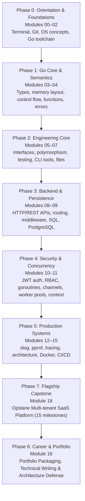
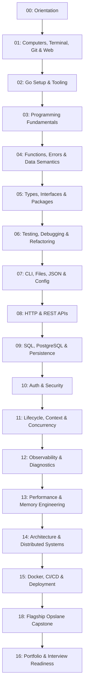

# The Go Engineer Progression (v3)

This document visualizes the canonical v3 learner journey from foundational concepts to production systems engineering on `release/v3`.

Module progression and item metadata are formally specified in [`curriculum/path.core.json`](../curriculum/path.core.json) and [ARCHITECTURE.md](../ARCHITECTURE.md).

## Phase Progression

## Module Flow

## Engineering Context Growth

| Phase | Learner Shift | Engineering Weight |
|---|---|---|
| **Phase 0: Foundations** (00–02) | Mental model of OS, process memory, and toolchain mechanics | Concrete, execution-level |
| **Phase 1: Go Core** (03–04) | Understand stack vs heap allocation, pointer semantics, errors | Foundational systems |
| **Phase 2: Engineering Core** (05–07) | Design structural polymorphism, test table suites, streaming I/O | Standard engineering |
| **Phase 3: Persistence** (08–09) | Build robust REST handlers, connection pools, and DB transactions | High, production-facing |
| **Phase 4: Concurrency** (10–11) | Coordinate bounded goroutine pools, cancellation, and JWT/RBAC | High, concurrency-critical |
| **Phase 5: Production Systems** (12–15) | Diagnose memory bottlenecks (`pprof`), trace requests, deploy via CI/CD | Advanced systems |
| **Phase 7: Flagship Capstone** (18) | Build multi-tenant SaaS backend with 15 progressive milestones | Full system integration |
| **Phase 6: Portfolio & Defense** (16) | Defend architecture, package production deliverables, interview prep | Professional readiness |

## Key Projects & Milestones

| Module | Project / Milestone | Core Deliverable | Verification Mode |
|---|---|---|---|
| `00` | Course Setup Verification | Verify runtime, editor, Git workflow, study plan | Automated script |
| `01` | Shell & Git Navigation Lab | Shell execution trace, commit hygiene | Terminal inspection |
| `02` | Tooling Failure Lab | Diagnose PATH drift, broken build tags, module conflicts | Red-to-green repair |
| `03` | Pricing Checkout & Contact Directory | Multi-branch pricing engine, pointer-backed address book | Unit test suite |
| `04` | Order Summary Refactor | Sentinel errors, custom error types, stack allocations | Table test suite |
| `05` | Bank Account & Payroll Processor | Interface abstraction, mockable polymorphism | Test suite with mocks |
| `06` | Bug Hunt Pack & Refactored Library | TDD bug fixes, benchmark assertions, coverage audit | Coverage + race tests |
| `07` | Config Parser & Log Analyzer | Streaming JSON decode, flag parsing, file I/O | CLI integration test |
| `08` | Book Catalog REST API | HTTP router, middleware chain, httptest fixtures | HTTP integration tests |
| `09` | Task API with PostgreSQL | Connection pooling, SQL migrations, ACID transactions | Database test suite |
| `10` | Secure Authenticated API | Bcrypt password hashing, JWT claims, RBAC middleware | Auth security tests |
| `11` | Bounded Worker Pool & Downloader | Worker pool, semaphore pattern, graceful context cancel | Race-detector test suite |
| `12` | Observability Retrofit | Structured `slog`, OpenTelemetry tracing, Prometheus | Metrics inspection |
| `13` | Performance & Memory Lab | Benchmark optimization, pprof heap/CPU analysis | Zero-alloc benchmarks |
| `14` | Modular Refactor Review | Hexagonal decoupling, domain invariants, ADR documentation | Domain boundary audit |
| `15` | Dockerized Production Service | Multi-stage Dockerfile, container health checks, CI/CD runbook | Docker health check |
| `18` | Flagship Opslane Platform | 15 milestones: multi-tenancy, workers, caching, graceful shutdown | Complete capstone suite |
| `16` | Portfolio Review Pack & Defense | Technical README, architecture diagrams, live defense answers | Portfolio rubric audit |

## Completion Standard

A learner who completes the curriculum demonstrates:

1. **Zero Magic Understanding:** Explains memory layouts, pointer dereferencing, goroutine scheduler mechanics, and CPU cache friendliness.
2. **Production Code Quality:** Idiomatic Go adhering to standard conventions, table-driven tests, race detection, and structured logging.
3. **Resilient Systems Engineering:** Defensive error classification, bounded concurrency, graceful shutdown, and resource leak prevention.
4. **Architectural Mastery:** Capable of designing, building, profiling, and defending multi-tenant backend systems at scale.
